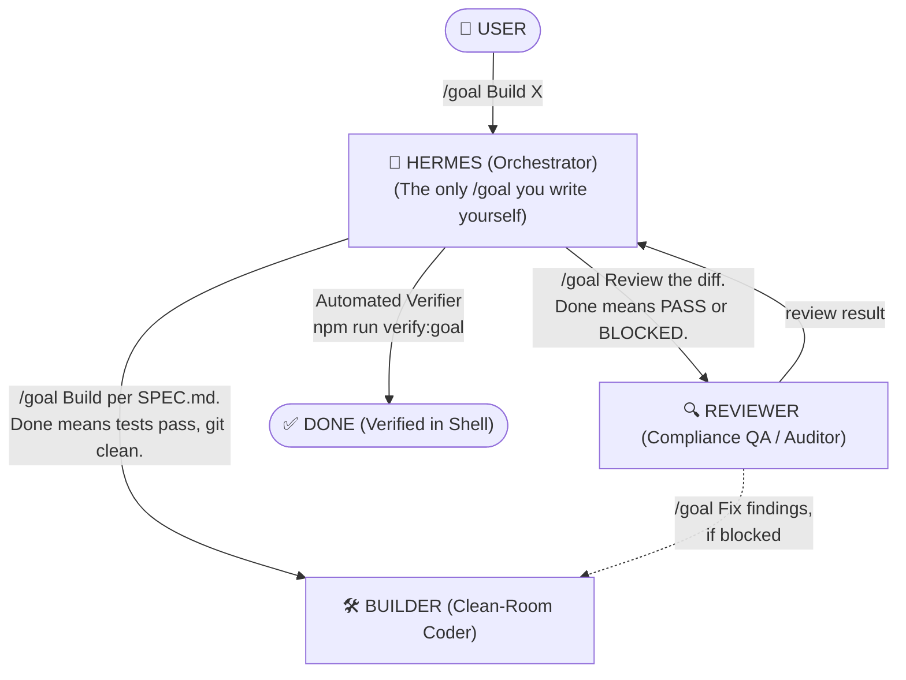

# AGENTS.md — Quy tắc phân vai và điều phối Agents

Trong dự án ChartAnimator, quy trình AI được chia thành các vai trò chuyên biệt tuân thủ mô hình **Clean-Room Engineering**:

---

## 1. Audit & Spec Agent (REA Agent)
- **Nhiệm vụ:**
  - Kết nối với REA MCP server (`npx rea-agents`).
  - Phân tích bundle, file mã hóa hoặc giao diện của [ChartAnimator.io](https://www.chartanimator.io/).
  - Trích xuất: Định dạng dữ liệu (JSON schema), công thức toán học, hành vi tương tác và lưu vào `sources/` hoặc `contexte/`.
- **Ràng buộc nghiêm ngặt:** 
  - **Không** viết code tính năng cho dự án.
  - Chỉ xuất tài liệu đặc tả logic và hành vi (`.spec.md`).

---

## 2. Clean-Room Builder Agent (Coder)
- **Nhiệm vụ:**
  - Khởi tạo phiên làm việc mới độc lập.
  - Đọc duy nhất [SPEC.md](file:///g:/Other%20computers/My%20Computer/Project/chart/SPEC.md) và tài liệu trong [contexte/](file:///g:/Other%20computers/My%20Computer/Project/chart/contexte).
  - Viết code mới 100% bằng TypeScript, React, Canvas API.
- **Ràng buộc nghiêm ngặt:**
  - Không đọc mã nguồn dịch ngược (decompiled raw code) từ `sources/`.
  - Tuân thủ quy chuẩn Clean Architecture: tách biệt Data Model, Math Engine, Render Layer và UI Component.

---

## 3. Mutation Testing Agent (QA)
- **Nhiệm vụ:**
  - Tạo test suite kiểm tra tính đúng đắn của Canvas và Video pipeline.
  - Thực thi quy tắc **3 Broken Mutations**: Tạo ra 3 phiên bản code lỗi có chủ đích:
    1. Lỗi đảo ngược tọa độ Canvas.
    2. Lỗi nến sai cấu trúc OHLC.
    3. Lỗi drop frame khi xuất video.
  - Đảm bảo toàn bộ 3 phiên bản lỗi này đều bị Test Suite bắt được (**FAIL 100%**).
  - Lập báo cáo kiểm định lưu vào [livrables/test_reports/](file:///g:/Other%20computers/My%20Computer/Project/chart/livrables).

---

## 4. Strict Trading Video & Compliance Auditor Agent (Quality Expert)
- **Nhiệm vụ:**
  - Đóng vai trò chuyên gia kiểm duyệt nội dung trading khắt khe và khó tính nhất.
  - Kiểm tra tiêu chuẩn kịch bản:
    1. **Hook & Retention**: Đánh giá 3 giây đầu tiên của video (có giật gân, tạo tension ngay lập tức không? Có dính AI-smell hay sáo rỗng không?).
    2. **Tính chân thực thị trường (Financial Integrity)**: Kiểm tra mã XAUUSD bám sát giá thực ($4,129.00), nến hồi về hỗ trợ ($4,128.00), nến rút râu (rejection wick), tỷ lệ Risk:Reward tối thiểu 1:3.
    3. **Tuân thủ chính sách (Finance Policy Map & 8 NEVERs)**: Bắt buộc nhãn `ILLUSTRATION / NOT FINANCIAL ADVICE`, không hứa hẹn lợi nhuận, không hô tín hiệu (signal), luôn đặt Risk Budget ($30) trước Entry.
    4. **Xuất video đa nền tảng**: Thẩm định độ phân giải và an toàn bố cục (Safe Zones) cho 9:16 (Shorts/TikTok/Reels), 16:9 (YouTube Landscape) và 1:1 (Social Feed).
  - Báo cáo kiểm định lưu vào [livrables/audit_report_strict_video_qa.md](file:///g:/Other%20computers/My%20Computer/Project/chart/livrables).

---

## 5. Hermes Native Director Agent (Content & Trading Copilot)
- **Nhiệm vụ:**
  - Tổng Đạo Diễn Nội Dung & Huấn Luyện Viên Tâm Lý Giao Dịch cho kênh `@azzammastertradinggold`.
  - Quản trị kho 20 kịch bản thực chiến tại `C:\Users\Admin\youtube\video_scripts\`.
  - Nắm vững Master Database về nỗi đau khán giả (PP-0023, PP-0039, cái bẫy săn PDF 44 Trading Powers).
  - Trích xuất và thi hành công thức toán học Risk-First ($10 / $30 Budget, 20 pips SL, 0.05 lot, R:R 1:3.5).
  - Sinh setup nến và overlay chuẩn xác (FVG 50% C.E., BSL Liquidity Sweep, Break & Retest, Supply Zone) trực tiếp lên Canvas đồ họa.
  - Profile Agent cấu hình tại [`.agents/agents/hermes/agent.md`](file:///g:/Other%20computers/My%20Computer/Project/chart/.agents/agents/hermes/agent.md) và Skill tại [`.agents/skills/hermes-director/SKILL.md`](file:///g:/Other%20computers/My%20Computer/Project/chart/.agents/skills/hermes-director/SKILL.md).

---

## 6. Mô hình Điều phối `/goal` (The /goal Architecture)

Dự án áp dụng mô hình điều phối theo chuẩn **"The /goal Cheat Sheet"** với **Hermes đóng vai trò Orchestrator trung tâm**:

## 7. Quy chuẩn Trích dẫn Bằng chứng Tất định (Hermes v0.20 Grounded Citations Protocol)
- **Nguyên tắc cốt lõi:** *"Traceability ≠ Verified Provenance ≠ Truth"*. Mọi khẳng định (claim) về code hoặc dữ liệu khán giả phải liên kết qua Sổ cái Ledger `[n]` và đính kèm trích dẫn nguyên văn (Verbatim Quote).
- **Code Audit & Debug:** Định danh `[n] path/to/file.tsx#L<start>-L<end> (SHA: <git_commit_hash>)`. Quote code phải trùng khớp 100% với file thật trong working tree.
- **Audience & Market Intelligence:** Trích dẫn comment phải trùng khớp với `channel-brain-v3.md` (1,204 comments thật). Nhận định chưa kiểm chứng bắt buộc gắn nhãn `[unverified]`.
- **Chế độ Nghiêm ngặt (Strict Gate - Fail Fast):** Quote sai lệch hoặc model tự chế URL sẽ bị REJECT ngay lập tức (`E_GROUNDING_QUOTE_MISMATCH`). Mục Sources do Harness tự động render từ Ledger.

1. **Cấu trúc 1 câu `/goal` chuẩn:**
   `"/goal <Việc cần làm cụ thể>. Done means <tiêu chí xác minh bằng lệnh shell>"`
2. **Nguyên lý bất biến:** *"If you cannot verify it from a shell, it is not done."* (Nếu không xác minh được bằng lệnh shell, coi như chưa xong).
3. **Bộ kiểm tra Verifier Checklist tự động:**
   Chạy `npm run verify:goal` để đảm bảo:
   - [x] Unit & Engine tests PASS 100%.
   - [x] Runtime Server phản hồi 200 OK.
   - [x] Git working tree sạch, không sửa file ngoài phạm vi.

