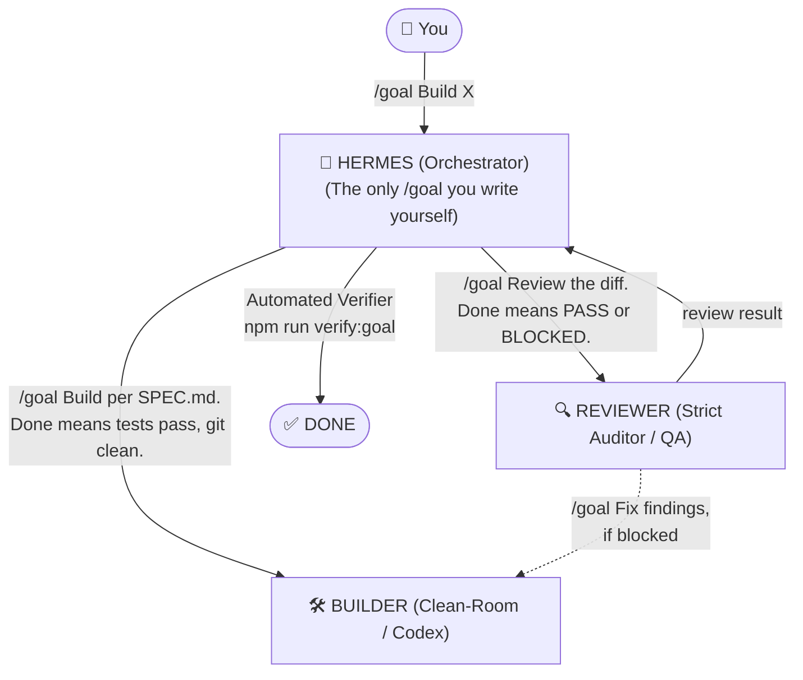

# The /goal Cheat Sheet — Architecture & Standards for ChartAnimator

> *Anatomy, templates, and failure modes for coding agents.*  
> **"You write one `/goal`. Hermes writes the rest."**

---

## 1. Anatomy of a Good `/goal`

```text
"/goal Build the app described in SPEC.md. Done means tests pass, build passes, README is accurate, and git status only shows relevant project files."
  ↑                     ↑                                               ↑                                              ↑
the primitive       what to do, specific and referenced             verifiable criteria                            commands the verifier can run
```

> [!IMPORTANT]
> **The Golden Rule:** If you cannot verify it from a shell, it is not done.

---

## 2. Who Receives `/goal`, and From Whom



- **You** write **one** high-level `/goal`.
- **Hermes (Orchestrator)** breaks it down and sends atomic `/goal` commands to the Worker agents:
  - **Builder Agent:** Executes code per specifications.
  - **Reviewer / QA Agent:** Audits diffs, checks compliance (8 NEVERs, OHLC, Safe Zones).
  - **Automated Verifier:** Executes shell checks (`npm test`, `git status`).

---

## 3. Anti-Patterns (DON'T vs. DO)

| DON'T | DO |
| :--- | :--- |
| ❌ `/goal make it better` | ✅ `/goal Refactor auth.ts. Done means all existing tests still pass and lint warnings drop below 5.` |
| ❌ `/goal fix the bug` | ✅ `/goal Fix issue 142. Done means the failing test in tests/auth.test.ts passes and no other tests regress.` |
| ❌ Open-ended criteria like *"make it good"* | ✅ Criteria a shell command can verify (`npm run test`, `node scripts/verify_goal.js`) |
| ❌ Trust the worker's word that it PASSED | ✅ Run the verifier command and check `git status` yourself |

---

## 4. Failure Modes & Recovery

1. ⚠️ **Agent claims done but build/tests never ran:**
   - *Recovery:* Re-run with the verifier command and check the actual shell exit code.
2. ⚠️ **Parallel goals fight over the same file:**
   - *Recovery:* Move parallel work to separate worktrees or independent branches.

---

## 5. The Verifier Checklist

Run via command:
```bash
npm run verify:goal
```

- [x] **Tests pass:** `npm test` (Vitest engine tests)
- [x] **Dev Server responds:** `http://localhost:3000` (200 OK)
- [x] **Git status clean:** Unrelated files are not dirtied
- [x] **Verifier output captured:** Raw terminal stdout captured, never summarized or faked.

> *"Workers change. The primitive stays the same."*
