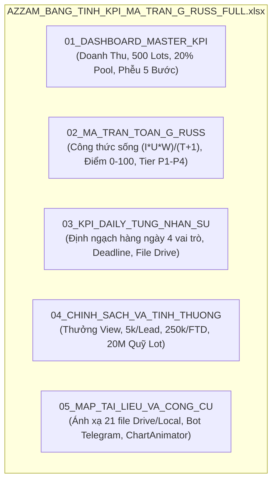

# BẢNG TÍNH EXCEL MASTER KPI & MA TRẬN TOÁN G RUSS (04:39)
## HỆ THỐNG ĐIỀU HÀNH KÊNH YOUTUBE & AFFILIATE IB VÀNG (XAUUSD) — @AZZAMMASTERTRADINGGOLD

---

> [!IMPORTANT]
> **TÀI LIỆU EXCEL ĐÃ XUẤT THÀNH CÔNG:**
> 1. Lưu tại kho Youtube chung: [`AZZAM_BANG_TINH_KPI_MA_TRAN_G_RUSS_FULL.xlsx`](file:///C:/Users/Admin/youtube/outputs/reports/AZZAM_BANG_TINH_KPI_MA_TRAN_G_RUSS_FULL.xlsx)
> 2. Lưu tại thư mục Livrables: [`AZZAM_BANG_TINH_KPI_MA_TRAN_G_RUSS_FULL.xlsx`](file:///g:/Other%20computers/My%20Computer/Project/chart/livrables/AZZAM_BANG_TINH_KPI_MA_TRAN_G_RUSS_FULL.xlsx)

---

### Cấu Trúc 5 Tab Chi Tiết Trong File Excel (.xlsx):

---

### Chi Tiết Từng Sheet Được Map Vào Dự Án:

#### Tab 1: `01_DASHBOARD_MASTER_KPI`
* **Mục tiêu cốt lõi:** Quản trị doanh thu hoa hồng Broker thụ động (\$4,000 / tháng = ~100M VNĐ từ 500 lots XAUUSD) và dòng tiền chia thưởng 20% (\$800 / tháng = ~20M VNĐ).
* **Bảng phễu chuyển đổi 5 bước (Conversion Engine):**
  1. *View (250,000) $\rightarrow$ Telegram Lead (1,000)*: CTR tối thiểu 0.4%.
  2. *Telegram Lead $\rightarrow$ Nhắn tin 1:1 với Sale (350)*: Tỷ lệ tương tác 35%.
  3. *Tư vấn 1:1 $\rightarrow$ Nạp vốn lần đầu FTD (30)*: Chuyển đổi FTD 8.6%.
  4. *Trader FTD $\rightarrow$ Up vốn cá voi \$2,000+ (10)*: Up vốn 33.3%.
  5. *Active Traders $\rightarrow$ 500 Lots/tháng*: 12.5 lots/người bình quân.

#### Tab 2: `02_MA_TRAN_TOAN_G_RUSS` (Engine Video 04:39)
* **Công thức Excel sống:**
  * Điểm thô: `=(D{row}*E{row}*F{row})/(G{row}+1)`
  * Điểm chuẩn hóa 0-100: `=MIN(100, ROUND((H{row}/150)*100, 1))`
  * Tự động phân cấp: `=IF(I{row}>=80, "P1 - CRITICAL (LÀM NGAY)", IF(I{row}>=50, "P2 - HIGH (TRONG NGÀY)", IF(I{row}>=20, "P3 - MEDIUM (ỦY QUYỀN)", "P4 - ELIMINATE (LÃNG PHÍ)"))))`
* **Danh mục nhiệm vụ thực chiến:**
  * **P1 (Điểm 90 - 100):** Ghim link Telegram, Setup bot tự động, Hỗ trợ Sale giải đáp nạp vốn FTD.
  * **P2 (Điểm 50 - 89):** Sản xuất 2 Shorts bám sát Pain point (Hook 0-3s), Đăng 4 nền tảng (TikTok, Reels, Shorts, FB), Viết kịch bản Long M15.
  * **P3 (Điểm 20 - 49):** Cào comment đối thủ, Cập nhật bộ từ khóa SEO, Báo cáo Analytics 21:30.
  * **P4 (Điểm < 20 - CẮT BỎ):** Ngồi chỉnh màu logo, đổi font chữ, cãi nhau trên mạng (Điểm 0.1 - lãng phí thời gian).

#### Tab 3: `03_KPI_DAILY_TUNG_NHAN_SU`
* **Content Lead & Kịch Bản:** 1 Kịch bản Long (8 phần) + 2 Kịch bản Shorts. Deadline 12:00 trưa. Gắn với `AZZAM_EVERGREEN_PLAN.xlsx` và `02_scripts.csv`.
* **SEO Researcher:** Cào 15 comments/pain points mới + 1 Bộ từ khóa. Deadline 11:00 sáng. Gắn với `AZZAM_PHAN_TICH_DOI_THU.xlsx`.
* **Video Editor:** Dựng & xuất 2 Shorts 9:16 + 1 Long/tuần. Deadline 17:00 chiều. Gắn với `AZZAM_ACTION_PLAN_EDITOR.docx`.
* **Distributor & Kênh Trưởng:** Đăng 4 nền tảng, Ghim link 100%, Nộp Scorecard 21:30 qua Telegram. Gắn với `AZZAM_REPURPOSE.xlsx`.
* **Sale Chăm 1:1:** Tư vấn 15 - 20 leads/ngày, chốt FTD $\ge 8\%$.

#### Tab 4: `04_CHINH_SACH_VA_TINH_THUONG`
* **Thưởng View:** Shorts 10k view (200k), 50k view (500k), 100k view (1.2M); Long 2k view (300k), 10k view (1M) có tiêu chuẩn giữ chân $\ge 60\%$.
* **Thưởng Data Lead:** 5.000đ / Lead thực + Thưởng mốc 1,000 leads (1.5M).
* **Thưởng Nạp FTD:** 150k - 500k theo mức nạp (\$100 - \$1,000+).
* **Chia Quỹ 20% Lot Commission Pool (20,000,000 VNĐ ở mốc 500 lots):**
  * 40% (8.000.000đ) cho Channel Owner / Distributor.
  * 35% (7.000.000đ) cho Content Lead & Script Writer.
  * 25% (5.000.000đ) cho Video Editor & Motion Lead.

#### Tab 5: `05_MAP_TAI_LIEU_VA_CONG_CU`
* Bảng tra cứu trực tiếp toàn bộ 21 tài liệu vận hành: Tên file, Quyền hạn, Input dữ liệu, Output đầu ra, Đường dẫn local/Drive và trạng thái kết nối tự động với Telegram Bot.
