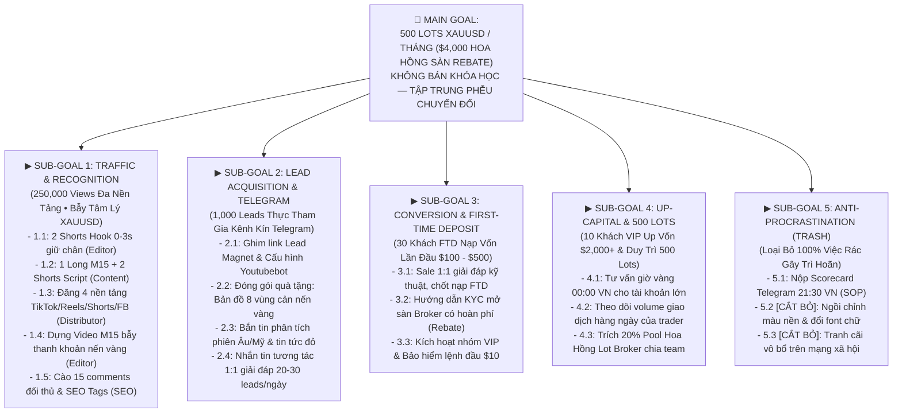

# BẢNG TÍNH EXCEL CLONE CHUẨN MẪU SUB-GOALS G RUSS (04:39)
## HỆ THỐNG ĐIỀU HÀNH KÊNH YOUTUBE & AFFILIATE IB VÀNG (XAUUSD) — @AZZAMMASTERTRADINGGOLD

---

> [!IMPORTANT]
> **ĐÃ CLONE Y CHANG MẪU SUB-GOALS TRONG 1 SHEET DUY NHẤT:**
> 1. Lưu tại kho Youtube chung: [`AZZAM_BANG_TINH_KPI_MA_TRAN_G_RUSS_FULL.xlsx`](file:///C:/Users/Admin/youtube/outputs/reports/AZZAM_BANG_TINH_KPI_MA_TRAN_G_RUSS_FULL.xlsx)
> 2. Lưu tại thư mục Livrables: [`AZZAM_BANG_TINH_KPI_MA_TRAN_G_RUSS_FULL.xlsx`](file:///g:/Other%20computers/My%20Computer/Project/chart/livrables/AZZAM_BANG_TINH_KPI_MA_TRAN_G_RUSS_FULL.xlsx)
> 3. GitHub Commit: `b2cd712` trên nhánh `main`.

---

### SƠ ĐỒ PHÂN RÃ HỆ THỐNG SUB-GOALS (G RUSS ARCHITECTURE):

---

### CẤU TRÚC CHI TIẾT 16 CỘT TÍNH TOÁN TOÁN HỌC TRONG BẢNG:

1. **STT:** Mã định danh nhiệm vụ theo từng Sub-Goal (1.1, 1.2, ..., 2.1, 2.2, ..., 5.3).
2. **Hành Động Cụ Thể (Action Task):** Tên nhiệm vụ thực chiến, rõ ràng, không chung chung.
3. **Vai Trò (Role):** Content Lead, SEO Researcher, Video Editor, Distributor, Sale Closer, Alan (Owner).
4. **Tác Động (Impact 1-10):** Mức độ trực tiếp tạo ra Lead và Tiền nạp.
5. **Khẩn Cấp (Urgency 1-10):** Tính cấp bách trong ngày theo chu kỳ phiên giao dịch.
6. **Trọng Số (Weight 1.0 - 3.0):** 3.0 (FTD/Tiền nạp), 2.5 (Lead Telegram), 2.0 (Video/Kịch bản), 1.2 (SEO), 0.1 (Việc rác).
7. **Thời Gian (Giờ):** Số giờ thực hiện ($T$).
8. **Raw Score (Công thức G Russ):** `=(D{row}*E{row}*F{row})/(G{row}+1)`.
9. **Điểm Ưu Tiên (0-100):** `=MIN(100, ROUND((H{row}/150)*100, 1))`.
10. **Phân Cấp Ưu Tiên (Tier):** 
    * `P1 - LÀM NGAY (CRITICAL)` (Điểm $\ge 80$)
    * `P2 - TRONG NGÀY (HIGH)` (Điểm $50 - 79$)
    * `P3 - ỦY QUYỀN (MEDIUM)` (Điểm $20 - 49$)
    * `P4 - CẮT BỎ (TRASH)` (Điểm $< 20$)
11. **Định Ngạch KPI (Target):** Chỉ tiêu bàn giao (ví dụ: 2 Shorts, 3 kịch bản, 20 leads, 2 FTDs).
12. **Thực Tế (Delivered):** Số lượng hoàn thành thực tế trong ngày.
13. **Tiến Độ (%):** Tỷ lệ phần trăm hoàn thành chỉ tiêu.
14. **Tiền Thưởng (VNĐ):** Công thức tự động nhân tiền (`Lead x 5.000đ`, `FTD x 250.000đ`, `Shorts milestone 200.000đ`, v.v.).
15. **Trạng Thái:** `HOÀN THÀNH` / `ĐANG LÀM` / `CẮT BỎ`.
16. **Tài Liệu SOP Sử Dụng:** Ánh xạ file Drive/Local (`AZZAM_EVERGREEN_PLAN.xlsx`, `02_scripts.csv`, `AZZAM_ACTION_PLAN_EDITOR.docx`, `AZZAM_REPURPOSE.xlsx`, Telegram Topic #1550).
