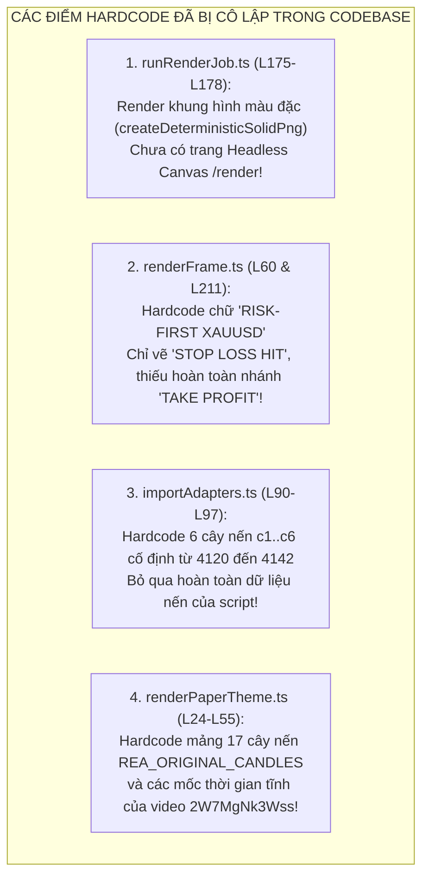
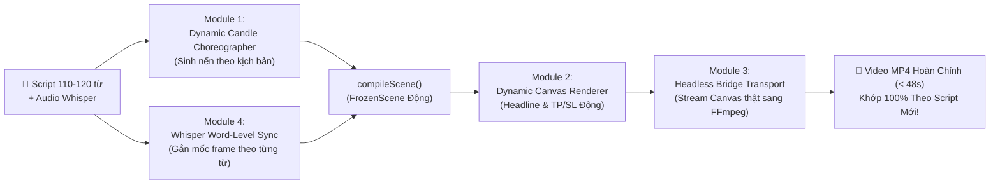

# SPEC — AI Competitor Remake to Dynamic Trading Short Engine v2
## (Đặc tả Hệ thống Đập Tan 4 Khối Hardcode & Chuyển Hóa Thành Pipeline Script-In $\to$ Dynamic Video Out)

- **Document ID:** `COMP-REMAKE-S2V-v2`
- **Revision:** `2.0.0` (Phê duyệt kiểm định Hardcode & Định vị Kiến trúc Động 100%)
- **Date:** `2026-11-10`
- **Status:** `SPEC_DESIGN_READY_FOR_REVIEW` (Planning & Spec Only — NO CODE BUILT)
- **Target Channels:** `@azzammastertradinggold` & Hệ sinh thái Đào tạo Azzam Academy (learn.azzamedu.com)
- **Baseline Engine:** `src/video/` (`contracts.ts`, `compileScene.ts`, `renderFrame.ts`, `audioTimeline.ts`, `layout.ts`, `runRenderJob.ts`)

---

## 1. Bản Đồ 7 Bước Quyết Định (The 7-Step Workflow Alignment)

Toàn bộ hệ thống tuân thủ chặt chẽ bảng quy trình tác chiến 7 bước đã được thống nhất:

| Bước | Nhiệm Vụ | Công Cụ & Trách Nhiệm | Ràng Buộc Kỹ Thuật (Constraints) |
| :---: | :--- | :--- | :--- |
| **1** | Lấy link video đối thủ (48h hoặc 7 ngày, view $\gg$ sub) | **Người thực hiện** (Không crawler tự động, không auto-upload) | Lọc các video có cấu trúc trực quan mạnh, view tăng đột biến. |
| **2** | Tách hook, nhịp dựng, loại shot | **`JuneYaooo/rea-video` + `bradautomates/claude-video`** | Phân tích Clean-Room: Bóc tách 0-3s hook, pacing, loại cảnh (chart vs face). |
| **3** | Giữ dạng hook, đổi lời và số liệu XAUUSD Risk-First | **Hermes Native Director Skills** | **Mục tiêu cứng: 110–120 từ** ($35s \le \text{duration} \le 48s$). Áp dụng Risk Budget $30, SL 20 pips. |
| **4** | Vẽ nến OHLC, FVG, Liquidity Sweep, SL/TP | **Canvas local (`StageCanvas`, `renderFrame`, `runRenderJob`)** | **Phải là Dynamic Engine**, xóa bỏ toàn bộ nến và text hardcode cũ. |
| **5** | Tạo giọng đọc TTS + mốc từng từ, rồi Mux video | **Kokoro TTS / Edge-TTS + Whisper/WhisperX + FFmpeg** | Đồng bộ chính xác từng âm tiết lời thoại với frame nến xuất hiện. |
| **6** | Human Polish: Thêm hiệu ứng âm thanh (SFX) | **CapCut PC qua `draft_content.json`** | Editor mở CapCut đã có sẵn 3 tracks, chỉ việc kéo thả SFX trong 15s. |
| **7** | Xuất xưởng video thương phẩm | **File local MP4 (1080x1920)** | Kiểm tra bằng lệnh: `ffprobe <= 48.00 giây` (Fail nếu $> 48.0s$). |

---

## 2. Báo Cáo Kiểm Định: Cô Lập 4 Khối Hardcode Cần Đập Tan

Quá trình audit mã nguồn hiện tại đã phát hiện 4 khối hardcode nghiêm trọng khiến video render ra **không thể chạy theo kịch bản mới**:



### Chi tiết vị trí lỗi:
1. **Khối 1 — Fake Solid PNG trong FFmpeg Transport:**
   - **File:** [`src/server/video/runRenderJob.ts#L175-L178`](file:///g:/Other%20computers/My%20Computer/Project/chart/src/server/video/runRenderJob.ts#L175-L178)
   - **Hiện trạng:** Khi không có `frameSource`, code fallback về:
     ```typescript
     const frameSource = options.frameSource || (async (idx: number) => createDeterministicSolidPng(1080, 1920, idx));
     ```
   - **Hậu quả:** File MP4 render ra thực chất chỉ là các mảng màu đơn sắc chớp nháy, chưa hề vẽ Canvas thật. Trang [`src/app/render/page.tsx`](file:///g:/Other%20computers/My%20Computer/Project/chart/src/app/render/page.tsx) hiện **chưa tồn tại**.

2. **Khối 2 — Chuỗi Ký Tự Ép Cứng trong Canvas Renderer:**
   - **File:** [`src/video/renderFrame.ts#L58-L65`](file:///g:/Other%20computers/My%20Computer/Project/chart/src/video/renderFrame.ts#L58-L65) và [`L211-L218`](file:///g:/Other%20computers/My%20Computer/Project/chart/src/video/renderFrame.ts#L211-L218)
   - **Hiện trạng:**
     - Tiêu đề bị vẽ chết: `ctx.fillText('RISK-FIRST XAUUSD', ...)` và `ctx.fillText('DEFINE LOSS BEFORE ENTRY', ...)`.
     - Kết quả lệnh bị vẽ chết: `ctx.fillText('❌ STOP LOSS HIT (-$30.00)', ...)`. Không có dòng code nào xử lý `TAKE_PROFIT`.
   - **Hậu quả:** Bất kể kịch bản mới nói về chủ đề gì hay chốt lời bao nhiêu, hình vẽ luôn chỉ hiện một tiêu đề cũ và báo cắn Stop Loss.

3. **Khối 3 — Gán Cứng 6 Cây Nến Mẫu trong Adapter:**
   - **File:** [`src/video/importAdapters.ts#L90-L97`](file:///g:/Other%20computers/My%20Computer/Project/chart/src/video/importAdapters.ts#L90-L97)
   - **Hiện trạng:** Mọi input (dù là brief hay chat) đều bị ép thành mảng `candles` gồm 6 cây nến có giá cố định: `4120.0, 4130.0, 4124.5, 4140.0, 4129.0, 4134.5`.
   - **Hậu quả:** Kịch bản phân tích nến mới của ngày hôm nay hoàn toàn không được đưa lên biểu đồ.

4. **Khối 4 — Khóa Chết Mảng 17 Nến trong Giao Diện Nền Giấy:**
   - **File:** [`src/components/canvas/renderPaperTheme.ts#L24-L55`](file:///g:/Other%20computers/My%20Computer/Project/chart/src/components/canvas/renderPaperTheme.ts#L24-L55)
   - **Hiện trạng:** Chứa mảng tĩnh `REA_ORIGINAL_CANDLES` sao chép từ video YouTube `2W7MgNk3Wss` kèm mốc thời gian xuất hiện cố định (`startSec: 1.0, 2.5, 4.0...`).
   - **Hậu quả:** Khi render Paper theme ở thời lượng 58.5s, hệ thống ép xem lại video cũ thay vì render kịch bản mới.

---

## 3. Kiến Trúc 4 Module Động Hóa (The 4 Anti-Hardcode Modules)

Để chuyển đổi thành công sang cơ chế **Script In $\to$ Dynamic Video Out**, bản Spec quy định 4 module phải được hiện thực hóa khi chuyển sang giai đoạn build:



### Module 1: Dynamic Candle Choreographer (`dynamicCandleChoreographer.ts`)
- **Nhiệm vụ:** Thay thế hoàn toàn mảng 6 nến hardcode trong `importAdapters.ts`.
- **Cơ chế hoạt động:**
  - Nhận diện hành động giá từ kịch bản (ví dụ: `SWEEP_HIGH_THEN_REVERSE` hoặc `PULLBACK_TO_FVG`).
  - Tự động sinh mảng nến OHLC chân thực bám sát giá XAUUSD thực tế (từ API `/api/market/gold` hoặc GBM Engine toán học).
  - Tự động gán nhãn $c_1, c_2, c_3$ cho vùng Fair Value Gap và tính toán Consequent Encroachment (C.E. 50%) theo công thức:
    $$\text{C.E. 50\%} = \frac{\text{Candle}_1.\text{high} + \text{Candle}_3.\text{low}}{2}$$

### Module 2: Dynamic Canvas Renderer (Nâng cấp `renderFrame.ts`)
- **Nhiệm vụ:** Loại bỏ toàn bộ chuỗi ký tự cứng trong hàm vẽ Canvas.
- **Cơ chế hoạt động:**
  1. **Dynamic Headline Zone:** Đọc trực tiếp từ `scene.draft.source.title` và `scene.draft.headline`:
     ```typescript
     const headline = scene.draft.headline || 'THỰC CHIẾN XAUUSD';
     const subline = scene.draft.subline || 'QUẢN TRỊ RỦI RO TRƯỚC TIÊN';
     ctx.fillText(headline.toUpperCase(), PROFILE_WIDTH / 2, 230);
     ctx.fillText(subline.toUpperCase(), PROFILE_WIDTH / 2, 290);
     ```
  2. **Dynamic Outcome Zone:** Hỗ trợ đa dạng trạng thái giao dịch:
     - Nếu `outcome === 'STOP_LOSS'`: Vẽ nhãn đỏ `❌ STOP LOSS HIT (-$30.00)` tại mức giá cắt lỗ.
     - Nếu `outcome === 'TAKE_PROFIT'`: Vẽ nhãn xanh ngọc `🎯 TAKE PROFIT HIT (+$105.00)` với tỷ lệ $R:R \ge 1:3.5$.
     - Nếu `outcome === 'NO_TRADE'`: Vẽ nhãn cảnh báo vàng `⚠️ BẪY THANH KHOẢN — ĐỨNG NGOÀI`.

### Module 3: Headless Render Bridge Transport (Nâng cấp `runRenderJob.ts`)
- **Nhiệm vụ:** Xóa bỏ hoàn toàn hàm tạo ảnh giả `createDeterministicSolidPng`, thay thế bằng Canvas Render thật 100%.
- **Cơ chế hoạt động:**
  1. Xây dựng trang render headless chuyên dụng tại [`src/app/render/page.tsx`](file:///g:/Other%20computers/My%20Computer/Project/chart/src/app/render/page.tsx) gắn thẻ Canvas `<canvas id="chart-render-canvas" width="1080" height="1920" />`.
  2. Supervisor khởi chạy Chromium Headless:
     - Nạp `FrozenScene` vào `window.chartAnimatorBridge`.
     - Chạy vòng lặp từ `frameIndex = 0` đến `scene.frameCount - 1`.
     - Gọi `renderFrame(ctx, scene, frameIndex)`, trích xuất PNG binary buffer trực tiếp qua `canvas.toBlob()`.
     - Bơm trực tiếp PNG buffer vào `pipe:0` của FFmpeg stdin theo cơ chế Backpressure (`drain`).

### Module 4: Whisper Word-Level Sync Engine (`whisperWordSync.ts`)
- **Nhiệm vụ:** Xóa bỏ việc chia thời gian đều hoặc gán giây tĩnh (`1.0s, 2.5s`).
- **Cơ chế hoạt động:**
  - Nhận file transcript JSON từ Whisper/WhisperX có chứa `words: [{ word: string, start: number, end: number }]`.
  - Ánh xạ từ khóa hành động trong kịch bản đến chính xác timestamp âm thanh:
    - Khi giọng đọc nói từ *"quét đỉnh"* ở giây `14.2s` $\implies$ Cây nến quét râu xuất hiện ở frame:
      $$\text{frameIndex} = \lfloor 14.2 \times 30 \rfloor = 426$$
    - Khi giọng đọc nói từ *"vùng FVG"* ở giây `21.8s` $\implies$ Hộp FVG xuất hiện ở frame:
      $$\text{frameIndex} = \lfloor 21.8 \times 30 \rfloor = 654$$

---

## 4. Đặc Tả Hợp Đồng Dữ Liệu Động (Dynamic Data Contracts)

Mở rộng `src/video/contracts.ts` để hỗ trợ toàn diện các trường động:

```typescript
export interface DynamicCompetitorRemakePayload {
  sourceVideoUrl: string;
  originalTranscript: string;
  
  // 1. Kịch bản viết lại đã kiểm duyệt (Hermes 5-Step)
  rewrittenScript: {
    title: string;        // e.g. "BẪY QUÉT THANH KHOẢN Á CHÂU"
    subline: string;      // e.g. "KHI ĐÁM ĐÔNG NGHĨ LÀ BREAKOUT"
    fullText: string;     // Ràng buộc: 110 <= totalWords <= 120
    targetDurationSec: number; // Ràng buộc: 35.0 <= duration <= 48.0
  };

  // 2. Tham số Quản trị Rủi ro (Aegis Policy)
  riskParams: {
    symbol: 'XAUUSD';
    riskBudgetUsd: 30; // $30 Risk Budget
    slPips: 20;        // 20 pips SL
    direction: 'BUY' | 'SELL';
    outcome: 'STOP_LOSS' | 'TAKE_PROFIT' | 'NO_TRADE';
    targetProfitUsd?: number; // e.g. 105.0 ($105.00)
  };

  // 3. Chuỗi nến động thực tế (Dynamic Candlesticks)
  candles: Array<{
    id: string;
    index: number;
    open: number;
    high: number;
    low: number;
    close: number;
    revealWordTrigger?: string; // Từ trong kịch bản kích hoạt nến này
  }>;

  // 4. Overlays động (SMC Fair Value Gap & Liquidity Levels)
  overlays: Array<{
    id: string;
    kind: 'FVG' | 'LEVEL' | 'ORDER_BLOCK';
    price?: number;
    low?: number;
    high?: number;
    label: string;
    revealWordTrigger?: string; // Từ trong kịch bản kích hoạt overlay này
  }>;

  // 5. Mốc thời gian từng từ (Whisper Timestamps)
  wordTimestamps: Array<{
    word: string;
    startSec: number;
    endSec: number;
  }>;
}
```

---

## 5. Ma Trận Kiểm Thử Phá Vỡ Hardcode (Mutation Acceptance Matrix)

Trước khi nghiệm thu bất kỳ bản build nào, Test Suite phải chứng minh đã triệt tiêu hoàn toàn 4 khối hardcode:

| Mã Kiểm Thử | Hành Động Thử Nghiệm | Tiêu Chí BẮT BUỘC ĐẠT (Assert) |
| :--- | :--- | :--- |
| **MUT-ANTI-01** | Nạp kịch bản với tiêu đề mới: `"BẪY FOMO Á CHÂU"`. | `FrameReceipt` và canvas OCR phải đọc được chuỗi `"BẪY FOMO Á CHÂU"`. **FAIL ngay lập tức** nếu xuất hiện chuỗi cũ `"RISK-FIRST XAUUSD"`. |
| **MUT-ANTI-02** | Nạp kịch bản với `outcome: 'TAKE_PROFIT'`, lời lãi `+$105.00`. | Khung hình cuối phải chứa nhãn xanh ngọc `TAKE PROFIT HIT (+$105.00)`. **FAIL ngay lập tức** nếu xuất hiện chữ `"STOP LOSS HIT"`. |
| **MUT-ANTI-03** | Nạp kịch bản với 12 cây nến mới có giá $4,150.0 \to $4,175.0. | Biểu đồ phải render đúng 12 cây nến với trục giá đỉnh $4,175.0. **FAIL ngay lập tức** nếu xuất hiện cụm giá $4,120.0 của Pilot cũ. |
| **MUT-ANTI-04** | Kiểm tra file MP4 xuất từ `runRenderJob`. | File video MP4 phải chứa các chuyển động nến thật của Canvas. **FAIL ngay lập tức** nếu phát hiện các khung hình solid block từ `createDeterministicSolidPng`. |
| **MUT-ANTI-05** | Đo thời lượng bằng `ffprobe`. | File MP4 thành phẩm đo được `duration <= 48.00s`. |

---
*Tài liệu đặc tả v2.0.0 đã cô lập chính xác 4 khối hardcode kỹ thuật và cung cấp giải pháp kiến trúc hoàn chỉnh để xây dựng hệ thống Script In $\to$ Dynamic Video Out 100%. Tuyệt đối chưa có dòng code tính năng nào được tự ý viết khi chưa có sự phê duyệt chính thức.*
