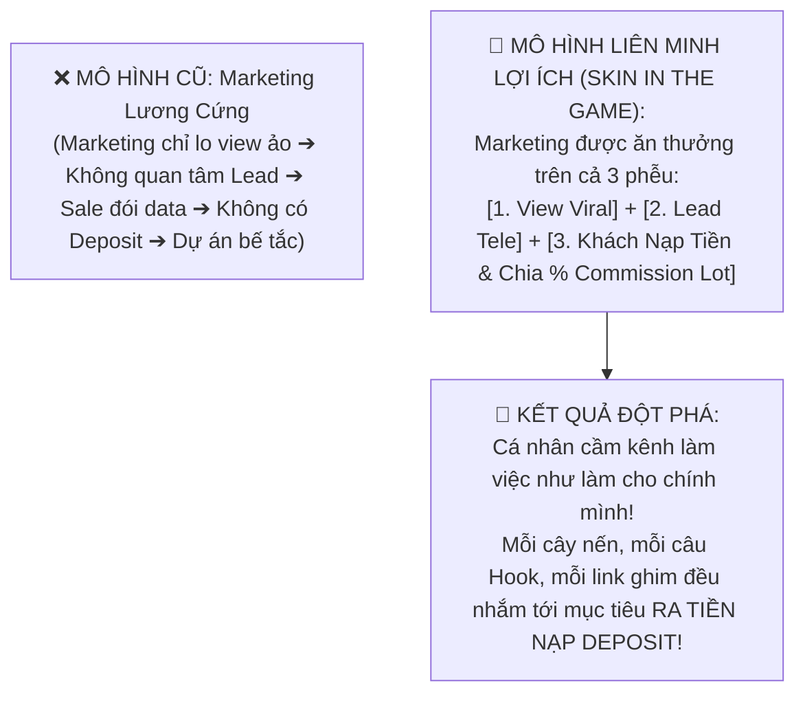
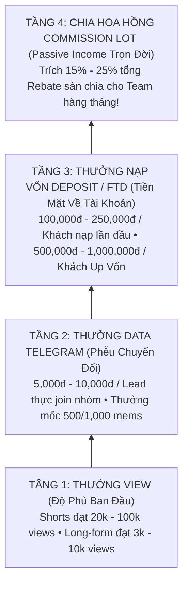

# CHÍNH SÁCH THƯỞNG ĐỘT PHÁ (INCENTIVE & COMMISSION SHARING) CHO CÁ NHÂN CẦN KÊNH & TEAM MARKETING (@AZZAMMASTERTRADINGGOLD)

> **Mục đích chiến lược:** Xóa bỏ hoàn toàn tư duy "làm công ăn lương đối phó" hoặc "trì hoãn chờ việc". Biến Cá nhân cầm kênh & Đội ngũ Marketing thành **Những người đồng sở hữu doanh số (Skin In The Game)**.  
> **Cơ chế 4 Tầng Thưởng Độc Quyền:**  
> 1. **Thưởng Mốc View:** Video Viral / Đạt mốc tổng view (Shorts & Long-form).  
> 2. **Thưởng Data Lead Telegram:** Thưởng theo đầu member thực join kênh + Thưởng vượt mốc 500/1,000 members.  
> 3. **Thưởng Khách Nạp Tiền (Deposit/FTD):** Thưởng nóng khi khách nạp lần đầu ($100-$500) và thưởng lớn khi khách UP VỐN VIP ($2,000+).  
> 4. **Trích Quỹ Hoa Hồng Khối Lượng (Commission Lot Sharing):** Trích 15% - 25% tổng hoa hồng sàn XAUUSD hàng tháng chia ngược lại cho Team!  
> **Nguyên tắc:** **KHÔNG BUILD CODE** — Tập trung vào Bảng Toán Học Thưởng, Công Thức ROI Chủ Doanh Nghiệp và Phản Biện Chiến Lược.

---

## PHẦN 1: BRAINSTORMING — ĐÒN BẨY TÂM LÝ & TẠI SAO PHẢI THƯỞNG 4 TẦNG?

### 1.1. Căn Bệnh "Tị Nạnh & Trì Hoãn" Của Đội Ngũ Truyền Thống
Tại sao 90% dự án YouTube Trading bị sập hoặc nhân sự nhảy việc sau 2 tháng?
- **Team Marketing / Editor nghĩ:** *"Mình cày ngày cày đêm làm video cho hay, kéo view cho nhiều, nhưng chỉ nhận 7-10 triệu lương cứng. Sale chốt được khách nạp tiền to thì Sale ăn đủ hoa hồng. Mắc gì mình phải cố gắng?"* $\rightarrow$ **Dẫn đến làm video qua loa, trì hoãn, không quan tâm video có ra lead hay không**.
- **Chủ kênh (Alan / CEO) nghĩ:** *"Sao view cao mà không có khách nạp tiền? Sao trả lương đều mà không ai chủ động?"*.

---

### 1.2. 4 Tầng Đòn Bẩy Thưởng (The 4-Tier Incentive Pyramid)

---

## PHẦN 2: PLAN — BẢNG QUY CHẾ THƯỞNG ĐỊNH LƯỢNG CHI TIẾT (VNĐ & USD)

### 2.1. TẦNG 1: CHÍNH SÁCH THƯỞNG THEO VIEW (SHORT & LONG-FORM)

*Điều kiện nghiệm thu:* View tự nhiên (Organic), không chạy tool/bot, Tỷ lệ xem trung bình (Average Percentage Viewed) $\ge 60\%$ đối với Shorts, $\ge 40\%$ đối với Long-form.

| Định dạng Video | Cột mốc View đạt được | Mức Thưởng Nóng (Spot Bonus) | Đối tượng nhận thưởng |
| :--- | :---: | :---: | :--- |
| **Shorts (TikTok / Reels / YT)** | **20,000 views** | **150,000 VNĐ** / video | 50% Content Lead + 50% Video Editor |
| **Shorts (TikTok / Reels / YT)** | **50,000 views** | **350,000 VNĐ** / video | 50% Content Lead + 50% Video Editor |
| **Shorts (TikTok / Reels / YT)** | **100,000 views** | **800,000 VNĐ** / video | 40% Content + 40% Editor + 20% Distributor |
| **Shorts Siêu Viral** | **$\ge$ 250,000 views** | **2,000,000 VNĐ** / video | Toàn đội Marketing chia đều |
| **Long-form Evergreen (YouTube)**| **3,000 views** | **300,000 VNĐ** / video | 50% Content Lead + 50% Video Editor |
| **Long-form Evergreen (YouTube)**| **10,000 views** | **1,000,000 VNĐ** / video | 50% Content Lead + 50% Video Editor |
| **Mốc Tổng View Kênh / Tháng** | **Đạt 300,000 views tổng** | **3,000,000 VNĐ** (Thưởng tháng) | Quỹ liên hoan / Thưởng nóng cả đội |

---

### 2.2. TẦNG 2: CHÍNH SÁCH THƯỞNG THEO DATA LEAD TELEGRAM

*Điều kiện nghiệm thu:* Thành viên vào Telegram là tài khoản thật (có tương tác, xem bài viết, không phải acc ảo spam).

- **Thưởng Theo Đầu Lead Hằng Ngày (Pay-per-Lead):**
  - Mỗi member mới join vào kênh Telegram từ link ghim video: **Thưởng 5,000 VNĐ / Lead**.
  - Nếu ngày hôm đó đạt mốc $\ge 50$ members mới: **Tăng lên 8,000 VNĐ / Lead** (Khuyến khích phá kỷ lục ngày).
- **Thưởng Cột Mốc Tích Lũy Thành Viên (Milestone Bonus):**
  - Kênh Telegram đạt **500 members thực**: Thưởng nóng **2,000,000 VNĐ**.
  - Kênh Telegram đạt **1,000 members thực**: Thưởng nóng **5,000,000 VNĐ**.
  - Kênh Telegram đạt **2,000 members thực**: Thưởng nóng **10,000,000 VNĐ**.
- *Phân bổ thưởng Lead:* **40% cho Cá nhân cầm kênh / Distributor (người tối ưu link ghim)** + **30% Content Lead** + **30% Editor**.

---

### 2.3. TẦNG 3: CHÍNH SÁCH THƯỞNG THEO KHÁCH NẠP TIỀN (DEPOSIT / FTD & UP VỐN)

*Điều kiện nghiệm thu:* Khách đăng ký link sàn Partner của kênh, nạp tiền thành công và vào tối thiểu 1 lệnh giao dịch Vàng XAUUSD.

| Loại Hành Động Nạp Tiền | Điều Kiện Mức Vốn Nạp | Mức Thưởng Nóng Cho Team Marketing / Kênh | Ghi chú & Tác động |
| :--- | :--- | :---: | :--- |
| **Khách Nạp Lần Đầu (FTD Nhỏ)** | **\$100 – \$499** | **100,000 VNĐ** / khách | Thưởng ngay khi khách có bill nạp thành công |
| **Khách Nạp Lần Đầu (FTD Chuẩn)** | **\$500 – \$1,999** | **250,000 VNĐ** / khách | Tệp khách đánh volume 0.05 lot đều đặn |
| **Khách UP VỐN VIP (Cá Voi)** | **\$2,000 – \$4,999** | **600,000 VNĐ** / khách | Tệp khách đi volume 0.2 - 0.5 lot/ngày |
| **Khách UP VỐN ĐẶC BIỆT** | **$\ge$ \$5,000** | **1,500,000 VNĐ** / khách | Cá voi tài khoản lớn, đi volume khủng |

---

### 2.4. TẦNG 4: CHÍNH SÁCH CHIA SẺ QUỸ HOA HỒNG LOT (COMMISSION POOL SHARING)

Đây là **vũ khí tối thượng** giữ chân nhân tài và biến cá nhân cầm kênh thành đối tác chiến lược:
- **Trích cố định 20% Tổng Doanh Thu Commission Sàn (Rebate Lot)** hàng tháng lập thành **Quỹ Thưởng Doanh Số Marketing**.
- *Ví dụ thực tế:*
  - Sàn trả hoa hồng \$8.00 / lot XAUUSD.
  - **Mức 300 Lots / Tháng** $\rightarrow$ Doanh thu = \$2,400 $\rightarrow$ **Trích 20% = \$480 (~12.2 triệu VNĐ)** chia thưởng cho team Marketing!
  - **Mức 500 Lots / Tháng** $\rightarrow$ Doanh thu = \$4,000 $\rightarrow$ **Trích 20% = \$800 (~20.4 triệu VNĐ)** chia thưởng cho team Marketing!
  - **Mức 1,000 Lots / Tháng** $\rightarrow$ Doanh thu = \$8,000 $\rightarrow$ **Trích 20% = \$1,600 (~40.8 triệu VNĐ)** chia thưởng cho team Marketing!

---

## PHẦN 3: SPEC — BẢNG MA TRẬN TOÁN HỌC G RUSS (@ 04:39) KẾT HỢP ĐỘNG LỰC TÀI CHÍNH

Áp dụng đúng công thức G Russ:
$$\text{Raw Priority Score} = \frac{\text{Impact} \times \text{Urgency} \times \text{Weight}}{\text{Time (Hours)} + 1}$$
$$\text{Final Priority Score} = \left(\frac{\text{Raw Score}}{\text{Max Raw Score}}\right) \times 100$$

- **`Weight` (Trọng số đối với việc ra TIỀN THẬT trong túi):**
  - Chăm Lead nạp tiền Deposit / FTD: $W = 10.0$
  - Ghim Link & Chốt Lead Tele: $W = 9.8$
  - Dựng Shorts có CTA kéo Lead: $W = 9.0$
  - Dựng Long-form tạo niềm tin Up Vốn: $W = 8.8$

### BẢNG XẾP HẠNG NHIỆM VỤ GẮN LIỀN VỚI THƯỞNG TIỀN MẶT:

| Hạng | Cá Nhân Đảm Nhiệm | Nhiệm Vụ Sinh Tiền | Thời Gian (T) | Impact | Urgency | Weight | Raw Score | Priority (0-100) | **KHOẢN TIỀN THƯỞNG TRỰC TIẾP NHẬN ĐƯỢC** |
| :---: | :--- | :--- | :---: | :---: | :---: | :---: | :---: | :---: | :--- |
| **🥇 1** | **Distributor** | **Ghim comment link Tele tặng file $10 Risk Budget lên video** | **0.3h** | **10** | **10** | **10.0** | **769.2** | **100.0** | 💵 **5,000đ – 8,000đ / Lead mới vào Tele (Ăn theo ngày)** |
| **🥈 2** | **Cá Nhân Cầm Kênh** | **Hỗ trợ Sale chốt khách nạp tiền FTD từ kịch bản video đã xem** | **0.5h** | **10** | **10** | **10.0** | **666.7** | **86.7** | 💵 **100,000đ – 250,000đ / khách nạp tiền thành công** |
| **🥉 3** | **Content + Editor** | **Xuất 2 Shorts nến giật gân có CTA Telegram từ ChartAnimator** | **1.2h** | **10** | **9** | **9.2** | **376.4** | **48.9** | 💵 **150k – 800k (khi video đạt mốc 20k - 100k views)** |
| **4** | **Cá Nhân Cầm Kênh** | **Hỗ trợ Sale tư vấn kỹ thuật nến giúp trader có lời để UP VỐN** | **1.0h** | **9** | **8** | **9.8** | **352.8** | **45.9** | 💵 **600,000đ – 1,500,000đ / khách UP VỐN VIP** |
| **5** | **Content + Editor** | **Dựng 1 Long-form 8 phút chuyên sâu để biến khách nhỏ thành Cá Voi** | **4.0h** | **9** | **7** | **8.8** | **110.9** | **14.4** | 💵 **300k – 1 triệu thưởng view + Hưởng % Commission Lot** |
| **6** | **Toàn Đội Marketing**| **Duy trì nhịp giao dịch đều đặn của khách để gom đủ 500 Lots/tháng** | **1.0h** | **9** | **9** | **9.5** | **384.8** | **50.0** | 💵 **~20.4 TRIỆU VNĐ / Tháng (20% Pool Commission)** |

---

## PHẦN 4: DEBATES — 5 CUỘC TRANH LUẬN CHIẾN LƯỢC VỀ CHÍNH SÁCH THƯỞNG

### 🥊 Tranh luận 1: "Thưởng theo View có sợ nhân sự dùng thủ thuật bơm view ảo để lấy tiền thưởng không?"
- **Cái bẫy:** Nhân sự thuê dịch vụ cày view bot rẻ tiền để đạt mốc 50,000 views nhận 350,000đ tiền thưởng!
- **Cơ chế kiểm soát chặt chẽ:**
  - View chỉ được tính thưởng khi thỏa mãn **3 điều kiện chống gian lận**:
    1. Tỷ lệ giữ chân người xem (Average View Duration) $\ge 60\%$.
    2. Nguồn lưu lượng (Traffic Source): $\ge 70\%$ từ YouTube Search, Shorts Feed, For You TikTok (loại bỏ traffic nghi bot từ bên thứ 3).
    3. **QUAN TRỌNG NHẤT: Tỷ lệ chuyển đổi ra Lead Tele $\ge 1.0\%$** (Nếu 50k view mà không có thêm mem nào vào Telegram $\rightarrow$ Không được xét thưởng view!).

---

### 🥊 Tranh luận 2: "Tại sao nên thưởng theo ĐẦU LEAD TELEGRAM (5,000đ/lead) thay vì chỉ thưởng khi khách nạp tiền?"
- **Tâm lý Marketing:** Từ lúc khách vào Telegram đến lúc khách nạp tiền deposit có thể mất 2-5 ngày qua tay đội Sale. Nếu chỉ thưởng khi khách nạp tiền, đội Marketing sẽ cảm thấy thành quả của mình phụ thuộc vào kỹ năng của Sale, dẫn đến nản lòng!
- **Giải pháp cân bằng động lực:**
  - **Thưởng 5,000đ/Lead** là phần thưởng khích lệ **tức thì (Instant Gratification)** giúp Marketing có tiền tươi mỗi ngày khi kéo được người thật vào nhóm.
  - **Thưởng Deposit và 20% Pool Commission** là phần thưởng **giá trị lớn (Big Win)** giúp Marketing gắn chặt trách nhiệm với chất lượng lead (kéo lead xịn thì khách nạp nhiều, ăn hoa hồng lot khủng).

---

### 🥊 Tranh luận 3: "Chia 20% Commission Lot cho Marketing thì Chủ Doanh Nghiệp (Alan / CEO) có bị thiệt không?"
- **Phép toán ROI của Chủ:**
  - Nếu không chia % commission: Trả lương cứng 10 triệu, nhân sự làm tà tà, kênh đạt 50 lots/tháng = \$400 commission $\rightarrow$ **Chủ lỗ nặng tiền lương!**
  - Nếu chia 20% commission: Nhân sự cày cuốc ngày đêm vì biết 500 lots họ được thưởng 20 triệu, 1,000 lots họ được thưởng 40 triệu.
  - Khi kênh đạt 1,000 lots (\$8,000 = ~204 triệu VNĐ):
    - Thưởng Marketing 20% = 40.8 triệu.
    - Thưởng Sale 25% = 51.0 triệu.
    - **Chủ Doanh Nghiệp còn lại 55% = 112.2 TRIỆU LỢI NHUẬN RÒNG RỦI RO BẰNG 0!**
  - Càng chia thưởng lớn, Chủ doanh nghiệp càng thu về số tiền khổng lồ!

---

### 🥊 Tranh luận 4: "Thưởng nóng hàng ngày (Daily Spot Bonus) vs Thưởng cuối tháng: Đâu là đòn bẩy triệt tiêu trì hoãn mạnh hơn?"
- **Sự thật khoa học thần kinh:** Trả thưởng cuối tháng tạo ra sự trì hoãn trong 25 ngày đầu, nhân sự chỉ chạy nước rút vào 5 ngày cuối.
- **Kỷ luật trả thưởng của Azzam Gold:**
  - **Thưởng nóng hằng ngày (Daily Spot Bonus):** Tiền thưởng Lead Telegram (5,000đ/lead) và thưởng video viral được **tổng kết và bắn ting ting vào 22:00 mỗi tối**!
  - Cảm giác mỗi tối mở app ngân hàng thấy nhận thêm 200k - 500k tiền thưởng nóng sẽ kích thích dopamine cực mạnh, khiến cả đội háo hức thức dậy sáng hôm sau để xuất bản video mới!

---

### 🥊 Tranh luận 5: "Phân bổ tiền thưởng trong đội Marketing thế nào để không tị nạnh nhau?"
- **Công thức phân bổ minh bạch theo tỷ lệ đóng góp:**
  - Đối với tiền thưởng View & Video Viral: **50% Content Lead** (người tạo ra Hook giữ chân) + **50% Video Editor** (người tạo nhịp thị giác nến).
  - Đối với tiền thưởng Lead Telegram: **40% Distributor / Cầm Kênh** (người ghim link và tối ưu chuyển đổi) + **30% Content** + **30% Editor**.
  - Đối với Quỹ Commission Lot 20% cuối tháng: Chia theo **Hệ số KPI tháng** của từng cá nhân (Ai đạt 100% KPI ngày nhận tròn hệ số, ai làm thiếu bị giảm trừ).

---

## BẢNG TỔNG KẾT HÀNH ĐỘNG HẰNG NGÀY & MỤC TIÊU THU NHẬP

Mục tiêu thu nhập khả thi của 1 Cá nhân cầm kênh / Nhân sự Marketing năng nổ:
- **Lương cứng cơ bản:** 8,000,000 VNĐ
- **Thưởng Lead Telegram (50 leads/ngày x 26 ngày x 5,000đ):** + 6,500,000 VNĐ
- **Thưởng Video Đạt Mốc View (4 video đạt mốc):** + 1,400,000 VNĐ
- **Thưởng Khách Nạp Tiền FTD (10 FTD x 250k):** + 2,500,000 VNĐ
- **Thưởng Chia Quỹ Commission Lot (Mức 500 lots):** + 6,800,000 VNĐ
👉 **TỔNG THU NHẬP HÀNG THÁNG: 25,200,000 VNĐ!**  
*(Một mức thu nhập cực kỳ hấp dẫn xóa sổ 100% sự trì hoãn và biến mọi thành viên thành chiến thần sản xuất nội dung!)*
