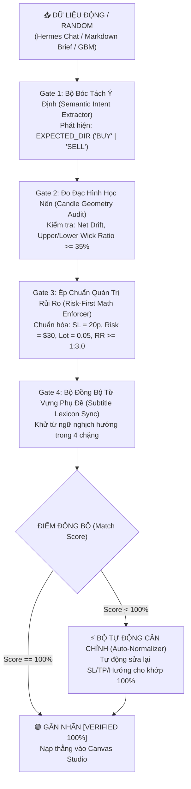

# ĐẶC TẢ KỸ THUẬT: BỘ KIỂM ĐỊNH NỘI DUNG ĐỘNG & TỰ ĐỘNG CHUẨN HÓA THỜI GIAN THỰC
## (SPEC-DYNAMIC-CONTENT-RUNTIME-VALIDATOR-AND-AUTO-NORMALIZER-v1)

- **Mã tài liệu:** `SPEC-DYNAMIC-CONTENT-RUNTIME-VALIDATOR-AND-AUTO-NORMALIZER-v1`
- **Phiên bản:** `1.0.0`
- **Trạng thái:** `PENDING_REVIEW`
- **Phạm vi áp dụng:** Bộ parser kịch bản (`BriefImporterModal.tsx`), Hermes AI Copilot (`HermesChatModal.tsx`, `hermesEngine.ts`), Bộ sinh nến GBM (`gbm.ts`), Canvas Render (`StageCanvas.tsx`).
- **Mục tiêu:** Đảm bảo mọi nội dung đưa vào **động, ngẫu nhiên hoặc sinh từ AI** đều được tự động đối soát ngữ nghĩa, kiểm định giải phẫu nến và ép chuẩn công thức Risk-First trước khi đưa lên Canvas xuất video.

---

## 1. BỐI CẢNH & NGUY CƠ ẢO GIÁC CỦA NỘI DUNG ĐỘNG

Khi nội dung không nằm trong thư viện mẫu tĩnh (Curated Templates) mà được đưa vào thông qua:
1. **Chat trực tiếp với Hermes AI Director** (Người dùng yêu cầu kịch bản mới).
2. **Dán văn bản kịch bản thô (Raw Brief Markdown)** từ Google Drive / Notion.
3. **Mô phỏng nến ngẫu nhiên bằng Brownian Motion (GBM)**.

Các mô hình AI và thuật toán ngẫu nhiên thường gặp 4 dạng **ảo giác kỹ thuật (Technical Hallucinations)**:
* **Ảo giác 1 (Lệch hướng 180°):** Tiêu đề nói *"Quét đáy phiên Á bật tăng bùng nổ"* nhưng AI sinh ra lệnh `SELL` hoặc chuỗi nến cắm đầu đi xuống.
* **Ảo giác 2 (Nến cụt râu):** Phụ đề thuyết minh *"Nhìn cây nến rút râu quét sạch phe mua"* nhưng cây nến tại vị trí đó là nến đặc thân không có bấc.
* **Ảo giác 3 (Phá vỡ kỷ luật vốn):** AI tự ý tính SL 50 pips hoặc TP 15 pips khiến tỷ lệ $R:R < 1:1$ hoặc rủi ro vọt lên \$150 thay vì \$30.
* **Ảo giác 4 (Lệch từ vựng phụ đề):** Kịch bản là lệnh BUY nhưng phụ đề lại dùng các từ tiêu cực *"bán tháo"*, *"xả hàng"*, *"sập hầm"*.

---

## 2. KIẾN TRÚC BỘ LỌC KIỂM ĐỊNH THỜI GIAN THỰC (THE 4-GATE RUNTIME PIPELINE)

Mọi đối tượng kịch bản động trước khi nạp vào `useChartStore` bắt buộc phải đi qua đường ống kiểm duyệt tự động:



---

## 3. ĐẶC TẢ CHI TIẾT 4 CHỐT CHẶN (GATE SPECIFICATION)

### 3.1. Gate 1 — Trích Xuất Ý Định Ngữ Nghĩa (Semantic Intent Extractor)
* **Hàm thực thi:** `extractSemanticIntent(title: string, briefText?: string): 'BUY' | 'SELL' | 'NEUTRAL'`
* **Từ điển từ khóa quy định:**
  * **Bộ từ khóa BUY (Tăng):** `BUY`, `LONG`, `QUÉT ĐÁY`, `HỖ TRỢ`, `SPRING`, `BẬT TĂNG`, `BÙNG NỔ`, `RECLAIM`, `BULLISH`, `DISPLACEMENT BUY`.
  * **Bộ từ khóa SELL (Giảm):** `SELL`, `SHORT`, `QUÉT ĐỈNH`, `KHÁNG CỰ`, `SUPPLY ZONE`, `SẬP`, `DUMP`, `CPI GIẬT`, `PHÂN PHỐI`, `BEARISH`, `DISPLACEMENT DUMP`.
* **Quy tắc:** Nếu tìm thấy từ khóa thuộc nhóm nào nhiều hơn $\implies$ Khóa cứng `expectedDirection` của kịch bản theo nhóm đó.

---

### 3.2. Gate 2 — Kiểm Tra Giải Phẫu Nến (Candle Geometry Audit)
* **Hàm thực thi:** `validateCandleGeometry(candles: Candle[], expectedDir: 'BUY' | 'SELL', triggerIndex: number): GeometryReport`
* **Tiêu chuẩn nghiệm thu hình thái:**
  1. **Độ dốc nến tổng thể (Net Trend Drift):**
     $$\Delta P = Close_{\text{cuối}} - Open_{\text{đầu}}$$
     * Nếu `expectedDir === 'BUY'`: Bắt buộc $\Delta P > 0$.
     * Nếu `expectedDir === 'SELL'`: Bắt buộc $\Delta P < 0$.
  2. **Tỷ lệ râu nến quét (Trigger Wick Ratio):**
     Tại cây nến kích hoạt `candles[triggerIndex]`:
     $$\text{TotalRange} = High - Low$$
     * Nếu quét đỉnh (`SELL`): $\text{UpperWickRatio} = \frac{High - \max(Open, Close)}{\text{TotalRange}} \ge 0.35$ (Râu trên $\ge 35\%$).
     * Nếu quét đáy (`BUY`): $\text{LowerWickRatio} = \frac{\min(Open, Close) - Low}{\text{TotalRange}} \ge 0.35$ (Râu dưới $\ge 35\%$).

---

### 3.3. Gate 3 — Ép Chuẩn Quản Trị Rủi Ro (Risk-First Math Enforcer)
Không cho phép AI tự tính toán bừa bãi. Hàm `enforceRiskFirstMath()` nhận vào giá `entry` và tự động sinh ra bộ thông số bất biến:
* **Quy chuẩn Vàng M15 của Kênh:**
  $$\text{SL Distance} = 2.0\text{ giá} = 20\text{ pips}$$
  $$\text{TP Distance} = 7.0\text{ giá} = 70\text{ pips} \implies R:R = \frac{70}{20} = 1:3.5$$
  $$\text{Risk Budget} = \$30 \implies \text{Lot Size} = 0.05\text{ lot}$$
* **Công thức tạo lệnh tự động:**
  * Nếu `BUY`: $\text{SL} = \text{Entry} - 2.0$, $\text{TP} = \text{Entry} + 7.0$.
  * Nếu `SELL`: $\text{SL} = \text{Entry} + 2.0$, $\text{TP} = \text{Entry} - 7.0$.
  * $\text{targetPips} = 210$ đến $350\text{ pips}$ (khớp với TP).

---

### 3.4. Gate 4 — Bộ Tự Động Cân Chỉnh (The Auto-Normalizer Engine)
Khi phát hiện dữ liệu động đưa vào bị lệch (ví dụ: người dùng gõ tiêu đề BUY nhưng Hermes sinh nến SELL hoặc ngược lại):
* **Cơ chế:** Hệ thống **không báo lỗi làm đơ màn hình**, mà tự động kích hoạt `normalizeSetup()`:
  1. Tự động lật ngược chiều lệnh (`type: 'BUY' \leftrightarrow 'SELL'`) cho khớp với tiêu đề.
  2. Tự động cập nhật nội dung ghim Callout Pin cho phù hợp (ví dụ: chuyển từ *"BẪY DỤ BUY"* thành *"QUÉT THANH KHOẢN ĐÁY"*).
  3. Tự động sinh lại bộ 4 câu phụ đề chuẩn xác theo hướng lệnh vừa được sửa.

---

## 4. GIAO DIỆN KIỂM ĐỊNH TRỰC QUAN (PRE-FLIGHT INTEGRITY PILL)

Trên Canvas Studio ([`src/components/StageCanvas.tsx`](file:///g:/Other%20computers/My%20Computer/Project/chart/src/components/StageCanvas.tsx)), ở góc trên bên phải (bên cạnh nhãn `ILLUSTRATION`), hiển thị một thanh kiểm định trạng thái:

* 🟢 **Khi mọi thứ khớp 100%:**
  `[✓ VERIFIED SETUP 100%]` (Màu xanh ngọc, tooltip hiển thị: *"Đúng hướng BUY · Nến rút râu 42% · RR 1:3.5 · SL $30"*).
* 🟡 **Khi có cảnh báo / phát hiện lệch:**
  `[⚠️ CẢNH BÁO LỆCH PHA - 1-CLICK TỰ SỬA]` (Màu vàng cam). Khi bấm vào, hệ thống tự động cân chỉnh lại toàn bộ thông số cho khớp.

---

## 5. ĐẶC TẢ GIAO DIỆN LẬP TRÌNH (TYPESCRIPT SCHEMA)

```typescript
export interface SetupValidationReport {
  isValid: boolean;
  score: number; // 0 - 100
  expectedDirection: 'BUY' | 'SELL' | 'NEUTRAL';
  checks: {
    titleDirectionMatch: boolean;
    candleDriftMatch: boolean;
    triggerWickValid: boolean;
    riskRewardValid: boolean;
    subtitlesAligned: boolean;
  };
  warnings: string[];
  normalizedSetup?: {
    executionOrder: ExecutionOrder;
    calloutPinText: string;
    calloutCandleIndex: number;
    targetPips: number;
    scriptSubtitles: ScriptSubtitle[];
  };
}
```

---

## 6. KẾ HOẠCH KIỂM THỬ TỰ ĐỘNG (VITEST SUITE)

Tạo test suite mới tại `tests/dynamicContentValidator.test.ts` kiểm tra 5 ca thử nghiệm khắc nghiệt:
1. **Ca 1 (Đầu vào chuẩn):** Dán brief chuẩn $\implies$ Trả về `isValid: true, score: 100`.
2. **Ca 2 (Nghịch hướng hoàn toàn):** Tiêu đề BUY nhưng đưa nến SELL $\implies$ Validator bắt lỗi thành công và `normalizedSetup` tự động lật lại thành BUY.
3. **Ca 3 (Nến không có râu):** Kịch bản Liquidity Sweep nhưng nến kích hoạt cụt râu $\implies$ Gắn cờ cảnh báo `triggerWickValid: false`.
4. **Ca 4 (Vi phạm tỷ lệ RR):** Lệnh có RR < 1:3 $\implies$ Auto-Normalizer tự động điều chỉnh lại TP để đạt $R:R \ge 1:3.5$.
5. **Ca 5 (Dữ liệu ngẫu nhiên GBM):** Sinh 100 bước Brownian walk $\implies$ Tự động tìm đỉnh/đáy để cắm ghim Callout Pin và đặt lệnh có lợi thế xác suất cao nhất.

