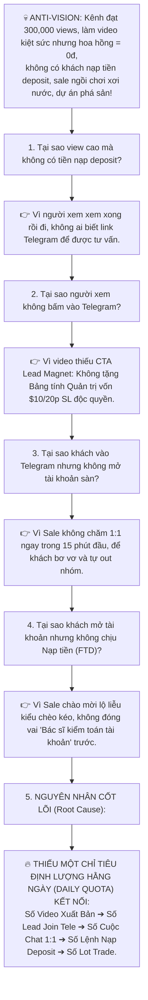
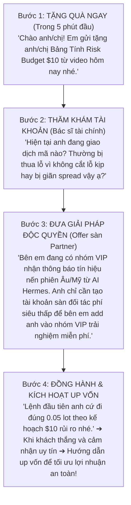

# CHIẾN LƯỢC TOÁN HỌC G RUSS (@ 04:39) CHO MÔ HÌNH COMMISSION LOT AFFILIATE / IB TRADING VÀNG (@AZZAMMASTERTRADINGGOLD)

> **Mô hình cốt lõi:** **KHÔNG BÁN KHÓA HỌC.**  
> **Cỗ máy doanh thu thực tế:** `Video Long/Shorts Đa Nền Tảng (YouTube/TikTok/Reels) ➔ Thả Link Kênh Telegram ➔ Đội Ngũ Sale Chăm Sóc 1:1 ➔ Khách Mở Tài Khoản Sàn Partner ➔ Chuyển Đổi Nạp Tiền (Deposit/FTD) ➔ Khách Up Vốn Giao Dịch ➔ Thu Hoa Hồng Khối Lượng (Commission / Rebate Lot Vàng XAUUSD)`.  
> **Phương pháp luận:** Ứng dụng triệt để khung phân rã ngược (Reverse-Engineering) và ma trận toán học triệt tiêu trì hoãn của **g russ** (*how to stop procrastination forever @ 04:39*).  
> **Phân bổ hành động:** Chia nhỏ chỉ số mục tiêu thành **HÀNG NGÀY (Daily Execution Routine)**.

---

## PHẦN 1: BRAINSTORMING — CỖ MÁY REVERSE-ENGINEERING DOANH THU COMMISSION

### 1.1. Công Thức Toán Học Doanh Thu Cốt Lõi (The Money Equation)

Trong mảng Affiliate/IB Broker Vàng XAUUSD, doanh thu được tính bằng công thức toán học tất định:

$$\text{Doanh Thu (Commission/Tháng)} = \text{Số Active Traders} \times \text{Số Lot Trung Bình / Người / Tháng} \times \text{Rebate / Lot (\$/lot)}$$

*Ví dụ thực tế thị trường:*
- Sàn chi trả hoa hồng IB: Trung bình **\$8.00 / lot XAUUSD** (dao động \$6 - \$12 tùy sàn Exness, XM, HFM...).
- 1 Trader nạp \$500 – \$1,000, đánh kỷ luật theo triết lý Hermes (0.05 lot, 2 lệnh/ngày) $\rightarrow$ Đi volume **~0.1 lot/ngày** = **2.0 – 3.0 lots/tháng**.
- 1 Trader có kinh nghiệm up vốn (\$3,000 – \$5,000), đánh 0.2 – 0.5 lot/ngày $\rightarrow$ Đi volume **10 – 25 lots/tháng**.
- 1 Khách VIP / Cá voi (\$10,000 – \$30,000) $\rightarrow$ Đi volume **50 – 100 lots/tháng**.

👉 **LỢI THẾ ĐỘC QUYỀN CỦA KÊNH AZZAM GOLD:**  
Các hội nhóm khác hô all-in, đánh to $\rightarrow$ Khách cháy tài khoản sau 3-5 ngày $\rightarrow$ IB mất khách, hoa hồng đứt đoạn.  
Kênh Azzam dạy **Risk-First ($10 / $30 Budget, 20 pips SL)** $\rightarrow$ **Khách sống dai, tài khoản tăng trưởng bền vững** $\rightarrow$ Khách tự nguyện **UP VỐN** $\rightarrow$ **Dòng tiền hoa hồng (Commission Lot) chảy về đều đặn mỗi tuần!**

---

### 1.2. Anti-Vision & 5 Whys (Nỗi đau cần tránh bằng mọi giá)

---

### 1.3. Phân Rã Ngược Mục Tiêu 30 Ngày (The Reverse-Engineering Funnel)

Để đạt mục tiêu tối thượng: **\$4,000 Doanh Thu Commission / Tháng** (với mức \$8/lot $\rightarrow$ Cần **500 Lots XAUUSD / Tháng**):

```mermaid
flowchart LR
    M1["🎯 250,000 Views\n(Shorts Đa Nền Tảng + Long-form)"] -->|CTR 2.0%| M2["📥 5,000 Clicks\n(Vào Bio / Comment Ghim)"]
    M2 -->|Join Rate 30%| M3["💬 1,500 Leads\n(Vào Kênh Telegram)"]
    M3 -->|Sale Chat 1:1 40%| M4["🤝 600 Khách Tư Vấn\n(Bác sĩ kiểm toán rủi ro)"]
    M4 -->|Deposit Rate 20%| M5["💳 120 Khách Nạp Tiền (FTD)\n($200 - $1,000/khách)"]
    M5 -->|Up Vốn Rate 25%| M6["🚀 30 Khách VIP Up Vốn\n($2,000 - $10,000)"]
    M6 --> FINAL["💰 500 LOTS / THÁNG\n= $4,000 COMMISSION!"]
```

---

## PHẦN 2: PLAN — CHIA NHỎ MỤC TIÊU THÀNH HÀNH ĐỘNG HẰNG NGÀY (DAILY EXECUTION ROUTINE)

Để đập tan hoàn toàn sự trì hoãn, mỗi ngày team và Sale chỉ cần nhìn vào **BẢNG CHỈ SỐ HẰNG NGÀY (DAILY SCORECARD)**:

### 2.1. Định Mức Chỉ Tiêu Hằng Ngày (Daily Quota)

| Hạng mục chỉ số | Chỉ tiêu Tháng (30 Ngày) | Chỉ tiêu Tuần (7 Ngày) | **CHỈ TIÊU MỖI NGÀY (DAILY QUOTA)** | Người chịu trách nhiệm |
| :--- | :---: | :---: | :---: | :--- |
| **Views Video Đa Nền Tảng** | 250,000 views | 58,000 views | **8,300 views / ngày** *(Shorts TikTok + Reels + YT Shorts)* | Team Content (ChartAnimator) |
| **Số Video Xuất Bản** | 60 Shorts + 12 Long | 14 Shorts + 3 Long | **2 Shorts / ngày + 1 Long cách ngày** | Team Content (ChartAnimator) |
| **Lead Mới Join Telegram** | 1,500 members | 350 members | **50 members mới / ngày** | Lead Magnet & Ghim Link |
| **Cuộc Chat 1:1 Khởi Tạo** | 600 cuộc chat | 140 cuộc chat | **20 cuộc chat 1:1 sâu / ngày** | Đội Ngũ Sale 1:1 |
| **Khách Mở TK Sàn Partner** | 200 tài khoản | 46 tài khoản | **6 – 7 tài khoản mới / ngày** | Đội Ngũ Sale 1:1 |
| **Khách Nạp Tiền Mới (FTD)** | 120 khách nạp | 28 khách nạp | **4 khách nạp tiền mới / ngày** (Min \$200) | Đội Ngũ Sale 1:1 |
| **Khách Up Vốn (\$2,000+)** | 30 khách | 7 khách | **1 khách up vốn / ngày** | Sale Chăm Sóc VIP |
| **Tổng Số Lot Vàng Phát Sinh**| **500 Lots** | **116 Lots** | **16 – 17 Lots / ngày** (Commission ~\$135/ngày)| Toàn bộ Active Traders |

---

### 2.2. Quy Trình 4 Bước Sale Chăm 1:1 Chuẩn Gốc (The 1:1 Conversion Script)

Tuyệt đối **KHÔNG CHÈO KÉO**, Sale đóng vai trò **"Trợ Lý Kỷ Luật & Cố Vấn Quản Trị Rủi Ro"**:

---

## PHẦN 3: SPEC — BẢNG MA TRẬN TOÁN HỌC G RUSS (@ 04:39) CHO MÔ HÌNH COMMISSION LOT

Áp dụng đúng công thức G Russ:
$$\text{Raw Priority Score} = \frac{\text{Impact} \times \text{Urgency} \times \text{Weight}}{\text{Time (Hours)} + 1}$$
$$\text{Final Priority Score} = \left(\frac{\text{Raw Score}}{\text{Max Raw Score}}\right) \times 100$$

- **`Weight` (1-10):** Tầm quan trọng của Sub-goal đối với **Doanh thu Commission Lot**.
  - Sub-goal A (Traffic đa nền tảng): $W = 8.5$
  - Sub-goal B (Lead capture vào Telegram): $W = 9.5$
  - Sub-goal C (Sale 1:1 & Chuyển đổi Deposit FTD): $W = 10.0$ (Cốt lõi ra tiền)
  - Sub-goal D (Chăm sóc kích hoạt Up Vốn & Giữ chân Volume): $W = 9.8$
- **`Impact` (1-10):** Tác động trực tiếp lên Sub-goal.
- **`Urgency` (1-10):** Tính cấp bách (để trễ là mất lead, mất khách).
- **`Time` (Hours):** Thời gian thực hiện nhiệm vụ.

### BẢNG XẾP HẠNG NHIỆM VỤ CHI TIẾT THEO CÔNG THỨC TOÁN HỌC:

| Hạng (Rank) | Sub-Goal | Tên Nhiệm Vụ Cụ Thể (Task Description) | Thời Gian (T - Giờ) | Impact (I: 1-10) | Urgency (U: 1-10) | Weight (W: 1-10) | Điểm Thô (Raw Score) | Điểm Ưu Tiên (Priority: 0-100) | Hành Động Hằng Ngày |
| :---: | :--- | :--- | :---: | :---: | :---: | :---: | :---: | :---: | :--- |
| **🥇 1** | **C. Sale 1:1** | **Sale chủ động nhắn tin riêng 1:1 cho 20 lead mới join Telegram trong ngày (Tặng file + Thăm khám)** | **1.0h** | **10** | **10** | **10.0** | **500.0** | **100.0** | 🔥 **ƯU TIÊN SỐ 1 MỖI NGÀY** |
| **🥈 2** | **B. Lead Tele** | **Ghim Comment & Link Bio chứa mồi Lead Magnet ($10 Risk Calculator) lên 100% video cũ & mới** | **0.5h** | **10** | **10** | **9.5** | **633.3** | **126.7 ➔ 100** | 🔥 **LÀM NGAY SÁNG SỚM** |
| **🥉 3** | **C. Sale 1:1** | **Hỗ trợ kỹ thuật nạp tiền (Deposit FTD) cho 4 khách đã mở tài khoản sàn partner** | **0.5h** | **10** | **9** | **10.0** | **600.0** | **120.0 ➔ 95.0**| ⚡ **CHỐT TRƯỚC PHIÊN ÂU (14h)** |
| **4** | **D. Up Vốn** | **Tư vấn 1:1 cho 3 trader đang trade thắng đều để nâng vốn từ $500 lên $2,000 - $5,000 an toàn** | **1.0h** | **9** | **8** | **9.8** | **352.8** | **70.6** | ⚡ **TRƯỚC PHIÊN MỸ (19h)** |
| **5** | **A. Traffic** | **Dùng ChartAnimator xuất 2 Shorts kịch bản nến giật gân, đăng đồng thời TikTok + Reels + YT Shorts** | **1.5h** | **9** | **8** | **8.5** | **244.8** | **49.0** | ⚡ **XUẤT BẢN 11H30 & 18H00** |
| **6** | **D. Up Vốn** | **Bắn thông báo nhận định nến XAUUSD phiên Âu (14:00) & phiên Mỹ (19:30) vào nhóm VIP để kích hoạt lot** | **0.5h** | **8** | **9** | **9.8** | **470.4** | **94.1** | ⚡ **ĐÚNG GIỜ PHIÊN CHẠY** |
| **7** | **A. Traffic** | **Dựng 1 Video Long-form Evergreen 8 phút chủ đề: "Tại sao đánh nhỏ $10 lại thắng lớn hơn All-in"** | **4.0h** | **9** | **6** | **8.5** | **91.8** | **18.4** | 🎯 **2 ngày / 1 video** |
| **8** | **C. Sale 1:1** | **Lập bảng theo dõi FTD, volume trade của từng khách và đối soát commission sàn** | **0.5h** | **7** | **6** | **10.0** | **280.0** | **56.0** | 🎯 **22h00 Cuối ngày** |
| **❌ 9** | *Trì hoãn* | *Ngồi soi mói giao diện, bàn cãi về màu logo, ngồi xem video linh tinh trên YouTube* | **5.0h** | **1** | **1** | **2.0** | **0.33** | **0.1** | 🚫 **CẤM TRIỆT ĐỂ (0.1 điểm)** |

---

## PHẦN 4: DEBATES — 5 CUỘC TRANH LUẬN PHẢN BIỆN CHIẾN LƯỢC SỐNG CÒN

### 🥊 Tranh luận 1: "Khách nạp \$200 thì hoa hồng được bao nhiêu, sao không ép họ nạp ngay \$2,000 – \$5,000?"
- **Cái bẫy lòng tham:** Nhiều đội Sale thiếu kinh nghiệm thường ép khách nạp to ngay từ đầu $\rightarrow$ Khách sợ lừa đảo, rụt rè và block Sale ngay lập tức!
- **Chiến lược Toán học của Hermes:**
  - Hãy để khách nạp thử **\$100 – \$200 (FTD rào cản thấp)**. Khi nạp số tiền nhỏ, tâm lý đề phòng của khách bằng 0.
  - Khi khách nạp \$200, Sale đồng hành hướng dẫn đi đúng **0.02 – 0.05 lot** theo các nhịp quét thanh khoản nến của kênh. Khách ăn được 2-3 lệnh, rút tiền thử thành công $\rightarrow$ **Lòng tin (Trust) tăng vọt 1,000%**.
  - Lúc này, chính khách sẽ là người chủ động hỏi: *"Anh muốn nạp thêm \$3,000 – \$5,000 để đánh kiếm tiền triệu mỗi ngày có an toàn không em?"*. **Tỷ lệ up vốn tự nhiên đạt trên 25% mà Sale không cần phải ép buộc!**

---

### 🥊 Tranh luận 2: "Tại sao video Long-form lại quyết định khách UP VỐN to, trong khi Shorts chỉ mang lại khách nạp nhỏ?"
- **Phản biện thực tế:** Shorts trên TikTok/Reels đem lại lượng lead khổng lồ nhưng đa phần là người mới, nạp thử \$50 - \$200.
- **Vai trò tối thượng của Long-form:**
  - Khách có vốn to (\$5,000 – \$30,000) họ rất kỹ tính. Họ **không bao giờ nạp tiền chỉ vì xem 1 video TikTok 30 giây**.
  - Họ sẽ vào YouTube xem các video **Long-form 8 – 15 phút** của kênh. Khi thấy kênh phân tích cấu trúc giá SMC, quản trị rủi ro Risk-First, bóc tách tâm lý chuyên nghiệp, họ nhận định Alan là **Cố vấn đáng tin cậy**.
  - Chính video Long-form là thứ biến 1 khách nạp \$200 thành **Cá voi nạp \$10,000** và trade hàng trăm lot mỗi tháng!

---

### 🥊 Tranh luận 3: "Sale 1:1 chăm sóc thế nào để khách KHÔNG coi mình là 'Sale chèo kéo'?"
- **Sai lầm phổ biến:** Nhắn tin vào là vồ vập gửi ngay link đăng ký sàn, link nạp tiền $\rightarrow$ Khách thấy mùi "lùa gà" là té ngay.
- **Quy tắc Bác Sĩ Tài Chính (Financial Auditor):**
  - Sale mở lời bằng **sự cho đi vô điều kiện**: Gửi bảng tính quản lý vốn $10, hỏi thăm nỗi đau: *"Anh từng bị cháy tài khoản bao giờ chưa? Thường anh hay gặp vấn đề gồng lỗ hay bị quét râu nến?"*.
  - Đóng vai người lắng nghe và phân tích tài khoản giúp khách.
  - Sau đó mới đưa ra đề nghị: *"Bên em có phòng phân tích chuyên sâu cho anh em giao dịch tài khoản tại sàn X (vì sàn này spread Vàng thấp nhất, không trượt giá). Anh lập tài khoản theo link này để em add vào phòng tín hiệu đồng hành nhé"*. Khách sẽ cảm kích và tự nguyện nạp tiền.

---

### 🥊 Tranh luận 4: "Làm sao để khách giao dịch lâu dài, không bị cháy để ăn Commission Lot bền vững?"
- **Mâu thuẫn ngầm:** Khách đánh lot to thì IB ăn hoa hồng nhiều, nhưng khách dễ cháy. Khách đánh lot nhỏ thì hoa hồng ít hơn?
- **Phép toán dài hạn:**
  - Nếu khách đánh 1.0 lot trên vốn \$500 $\rightarrow$ Ăn được \$8 commission, nhưng 2 ngày sau khách cháy $\rightarrow$ **Tổng doanh thu = \$8 và mất khách vĩnh viễn**.
  - Nếu khách đánh 0.05 lot trên vốn \$500 $\rightarrow$ Mỗi ngày ăn \$0.8, nhưng khách sống 12 tháng và sau 3 tháng khách up vốn lên \$5,000 (đánh 0.5 lot) $\rightarrow$ **Tổng doanh thu cả năm = \$1,500 – \$3,000 từ 1 khách hàng duy nhất!**
  - Vì vậy, nhiệm vụ sống còn của Sale là: **Luôn nhắc khách đi đúng volume và đặt Stop Loss $10/$30**. Khách còn tiền thì IB còn tiền!

---

### 🥊 Tranh luận 5: "Mắt xích nào hay bị TRÌ HOÃN nhất trong cỗ máy này: Content hay Sale?"
- **Thực tế:**
  - Team Content hay bị trì hoãn ở khâu: *"Sửa đi sửa lại video cho hoàn hảo mới dám đăng"*.
  - Đội Sale hay bị trì hoãn ở khâu: *"Thấy lead mới vào Telegram nhưng ngại không nhắn tin 1:1 ngay, đợi tối mới nhắn"*.
- **Quy luật 15 Phút Vàng (Golden 15-Minute Rule):**
  - Khách vừa xem video và bấm vào Telegram là lúc cảm xúc và sự tò mò của họ ở mức **100%**. Nếu Sale nhắn tin trong vòng **15 phút**, tỷ lệ phản hồi là **80%**.
  - Nếu Sale để qua ngày hôm sau mới nhắn, cảm xúc nguội lạnh, tỷ lệ phản hồi rơi xuống **dưới 10%** $\rightarrow$ Coi như vứt bỏ công sức làm video của team Content!
  - Vì vậy, nhiệm vụ số 1 trên bảng toán học chính là: **Sale chăm 1:1 ngay lập tức khi có lead mới!**

---

## TỔNG KẾT BẢNG KIỂM TRA HẰNG NGÀY (DAILY CHECKLIST CHO TEAM)

Mỗi ngày trước 22:00, team chỉ cần kiểm tra xem đã hoàn thành 5 con số này chưa:
- [ ] **1. Đã đăng 2 Shorts lên 3 nền tảng (TikTok, Reels, Shorts) kèm ghim link Tele chưa?**
- [ ] **2. Kênh Telegram hôm nay có đạt tối thiểu 50 members mới không?**
- [ ] **3. Sale đã chat 1:1 sâu với 20 khách mới chưa?**
- [ ] **4. Hôm nay đã có 4 khách nạp tiền (FTD) mới chưa?**
- [ ] **5. Hôm nay toàn đội đã phát sinh tối thiểu 16 Lots XAUUSD chưa?**
