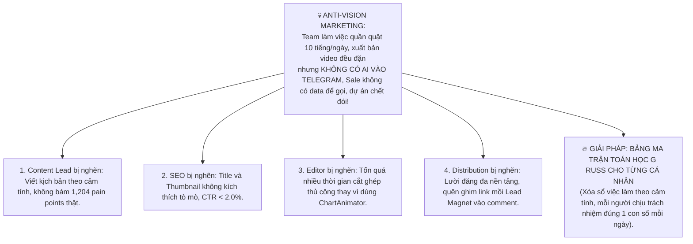
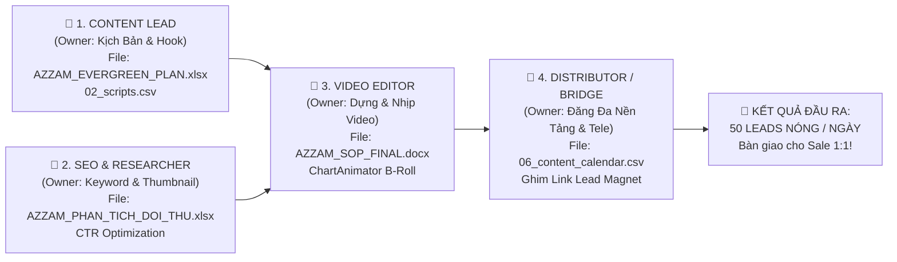

# CHIẾN LƯỢC TOÁN HỌC G RUSS (@ 04:39) CHO ĐỘI NGŨ MARKETING TỪNG CÁ NHÂN & MAP DỮ LIỆU VIDEO SHEET (@AZZAMMASTERTRADINGGOLD)

> **Phạm vi chiến lược:** **DÀNH RIÊNG CHO ĐỘI NGŨ MARKETING & SẢN XUẤT NỘI DUNG (TỪNG VAI TRÒ CÁ NHÂN)**.  
> **Nhiệm vụ tối thượng của Marketing:** Không phải "cày view ảo tự sướng", mà là **Tạo ra dòng người xem chất lượng cao từ Video (Long-form & Shorts Đa Nền Tảng) ➔ Click Link Ghim ➔ Bàn Giao Tối Thiểu 50 LEADS NÓNG / NGÀY Vào Kênh Telegram Cho Sale Chăm 1:1**.  
> **Dữ liệu gốc được tích hợp (Mapped Sheets & Docs):**  
> - Bảng kế hoạch nội dung: `AZZAM_EVERGREEN_PLAN.xlsx` (24 chủ đề Evergreen gắn 1,204 pain points).  
> - Lịch nội dung đang chạy: `06_content_calendar.csv`.  
> - Kho kịch bản đang chạy: `02_scripts.csv` (77 kịch bản).  
> - Phân tích đối thủ & từ khóa: `AZZAM_PHAN_TICH_DOI_THU.xlsx`.  
> - Quy chuẩn sản xuất: `MRBEAST_SOP.md` & `AZZAM_SOP_FINAL.docx`.  
> - Bản đồ điều phối: `outputs/reports/TEAM_DOCUMENT_MAP.md`.  
> **Nguyên tắc:** **KHÔNG BUILD CODE** — Tập trung 100% vào Định Mức Hằng Ngày, Bảng Ma Trận Toán Học và Phản Biện Đa Chiều.

---

## PHẦN 1: BRAINSTORMING — CƠ CẤU VAI TRÒ ĐỘI MARKETING & MAP DỮ LIỆU SHEET

### 1.1. Anti-Vision của Đội Ngũ Marketing (Nỗi sợ cần triệt tiêu)
Theo G Russ, Marketing hay bị căn bệnh **"Productive Procrastination" (Trì hoãn giả vờ bận rộn)**:
- Ngồi họp bàn ý tưởng mới trên mây cả tuần trong khi bảng `AZZAM_EVERGREEN_PLAN.xlsx` có sẵn 24 chủ đề chưa làm.
- Editor ngồi chỉnh màu, chọn nhạc nền mất 8 tiếng cho 1 video mà Hook 0-3s dở tệ, người xem lướt qua sau 1 giây.
- Đăng video lên YouTube xong rồi bỏ quên, không đăng TikTok/Reels, không ghim link Telegram, dẫn đến **View có nhưng Lead vào Telegram = 0**.

---

### 1.2. Bản Đồ Phân Vai 4 Cá Nhân Trong Đội Marketing & Tệp Dữ Liệu Sheet Tương Ứng

Dựa trên tài liệu gốc `outputs/reports/TEAM_DOCUMENT_MAP.md`:

1. **Cá nhân 1: CONTENT LEAD (Chịu trách nhiệm: Kịch bản, Hook 0-3s & Lời thoại CTA)**
   - *File gốc quản lý:* `AZZAM_EVERGREEN_PLAN.xlsx` (bảng 24 video Evergreen) + `02_scripts.csv`.
   - *Nhiệm vụ cốt lõi:* Bốc đúng chủ đề từ sheet, viết Hook 0-3s loại bỏ 100% sáo rỗng AI, gắn chặt triết lý Risk-First ($10 / 20 pips SL), và chốt video bằng câu kêu gọi: *"Nhận bảng tính quản lý vốn tại link Telegram ở comment!"*.
2. **Cá nhân 2: SEO & RESEARCH SPECIALIST (Chịu trách nhiệm: Khoảng trống đối thủ, Title, Thumbnail CTR)**
   - *File gốc quản lý:* `AZZAM_PHAN_TICH_DOI_THU.xlsx` (240 video đối thủ, 4,028 comments) + `AZZAM_BAOCAO_PHAN_TICH_DOI_THU.docx`.
   - *Nhiệm vụ cốt lõi:* Soi đối thủ lớn (Jasmine Fx, TTrades) xem họ đang thiếu gì để điền vào khoảng trống; giật Title dưới 50 ký tự; thiết kế Thumbnail tạo tương phản cao để đẩy **CTR $\ge 5\%$**.
3. **Cá nhân 3: VIDEO EDITOR & CHART OPERATOR (Chịu trách nhiệm: Dựng nhịp, Âm thanh TTS, B-Roll ChartAnimator)**
   - *File gốc quản lý:* `AZZAM_SOP_FINAL.docx`, `MRBEAST_SOP.md`, `03_media_assets.csv`, `04_video_drafts.csv`.
   - *Nhiệm vụ cốt lõi:* Sử dụng ChartAnimator nạp setup nến trong 30 giây; khớp chuẩn phụ đề và giọng đọc Gemini Flash TTS; cắt bỏ 100% khoảng lặng (dead air); đảm bảo nhịp giật 1.5 - 2.5s/cắt cảnh.
4. **Cá nhân 4: MULTI-PLATFORM DISTRIBUTOR & TELEGRAM BRIDGE (Chịu trách nhiệm: Đăng đa nền tảng & Ghim Link Lead)**
   - *File gốc quản lý:* `06_content_calendar.csv` (lịch phát sóng) + `05_published_videos.csv`.
   - *Nhiệm vụ cốt lõi:* Đăng đồng thời 1 video Shorts lên **YouTube Shorts, TikTok, Facebook Reels**; gắn Bio link sạch; ghim comment Lead Magnet tặng file Risk Calculator lên đầu; đo lường số lượt click link Tele.

---

## PHẦN 2: PLAN — BẢNG ĐỊNH MỨC HẰNG NGÀY (DAILY QUOTA) CHO TỪNG CÁ NHÂN

Không giao việc chung chung! Mỗi cá nhân trong đội Marketing có **KPI ĐỊNH LƯỢNG HẰNG NGÀY** rõ ràng trước 18:00:

| Cá Nhân / Vai Trò | Tệp Sheet / File Làm Việc Chính | **CHỈ TIÊU HẰNG NGÀY (DAILY QUOTA)** | Tiêu Chuẩn Nghiệm Thu (Acceptance Criteria) |
| :--- | :--- | :--- | :--- |
| **1. Content Lead** | `AZZAM_EVERGREEN_PLAN.xlsx` `02_scripts.csv` | **2 Kịch bản Shorts + 1/2 Kịch bản Long-form** | - Hook 0-3s dưới 6 từ in hoa. - Có dẫn chứng nến mã XAUUSD thực tế ($4,128). - CTA kêu gọi join Telegram tặng bảng tính. |
| **2. SEO & Researcher** | `AZZAM_PHAN_TICH_DOI_THU.xlsx` `06_content_calendar.csv` | **Tối ưu 3 Bộ Title + Thẻ Tag + Phác thảo 2 Thumbnail** | - Title bám từ khóa có volume tìm kiếm cao. - Thumbnail text dưới 4 từ, màu sắc tương phản cao. - CTR mục tiêu $\ge 5.0\%$. |
| **3. Video Editor** | `AZZAM_SOP_FINAL.docx` `ChartAnimator.io` | **Dựng hoàn thiện 2 Shorts (9:16) + 1 Long cách ngày (16:9)** | - 100% B-Roll nến xuất từ ChartAnimator. - Audio TTS và phụ đề khớp 100% nhịp đọc. - Safe-Zone 9:16 không bị che nút Like/Share. |
| **4. Multi-Platform Distributor** | `06_content_calendar.csv` `Kênh Telegram / Linktree` | **Đăng 2 Shorts lên 3 Nền Tảng (Tổng 6 lượt đăng) + Ghim 100% Link** | - Xuất bản đúng giờ vàng (11:30 & 18:00 VN). - Ghim comment có link Tele tặng quà ngay sau khi đăng 1 phút. - Đạt **$\ge 50$ mem mới vào Telegram**. |

---

## PHẦN 3: SPEC — BẢNG MA TRẬN TOÁN HỌC G RUSS (@ 04:39) CHO ĐỘI MARKETING

Áp dụng đúng công thức G Russ:
$$\text{Raw Priority Score} = \frac{\text{Impact} \times \text{Urgency} \times \text{Weight}}{\text{Time (Hours)} + 1}$$
$$\text{Final Priority Score} = \left(\frac{\text{Raw Score}}{\text{Max Raw Score}}\right) \times 100$$

- **`Weight` (Trọng số Sub-goal đối với mục tiêu kéo Lead vào Telegram):**
  - Sub-goal A (Bridge & Ghim Link Tele): $W = 10.0$ (Cầu nối sống còn để ra lead)
  - Sub-goal B (Dựng Shorts Đa Nền Tảng): $W = 9.2$ (Traffic phủ rộng)
  - Sub-goal C (Kịch Bản Pain Point Gốc): $W = 9.0$ (Quyết định retention)
  - Sub-goal D (SEO & Thumbnail CTR): $W = 8.5$ (Quyết định số lượt click xem)
  - Sub-goal E (Long-form Evergreen): $W = 8.8$ (Tạo uy tín sâu)
- **`Impact` (1-10):** Tác động trực tiếp lên Sub-goal của cá nhân.
- **`Urgency` (1-10):** Mức độ khẩn cấp (chậm trễ là gãy nhịp phân phối).
- **`Time` (Hours):** Thời gian thực hiện tính bằng giờ.

### BẢNG XẾP HẠNG NHIỆM VỤ CHI TIẾT THEO CÔNG THỨC TOÁN HỌC:

| Hạng | Cá Nhân Đảm Nhiệm | Sheet Map | Tên Nhiệm Vụ Cụ Thể (Task Description) | Thời Gian (T - Giờ) | Impact (I) | Urgency (U) | Weight (W) | Điểm Thô (Raw Score) | Điểm Ưu Tiên (0-100) | Hành Động Bắt Buộc |
| :---: | :--- | :--- | :--- | :---: | :---: | :---: | :---: | :---: | :---: | :--- |
| **🥇 1** | **Distributor** | `06_content_calendar` | **Ghim comment link Telegram mồi Lead Magnet lên toàn bộ video mới đăng trong ngày & video top views cũ** | **0.3h** | **10** | **10** | **10.0** | **769.2** | **100.0** | 🔥 **LÀM NGAY KHI VIDEO LÊN** |
| **🥈 2** | **Content Lead** | `AZZAM_EVERGREEN_PLAN` | **Bốc 2 chủ đề pain point từ sheet (PP-0023, PP-0039), viết 2 kịch bản Shorts bám sát công thức Risk-First $10** | **1.0h** | **9** | **9** | **9.0** | **364.5** | **47.4** | ⚡ **HOÀN THÀNH TRƯỚC 10:00 SÁNG** |
| **🥉 3** | **Video Editor** | `AZZAM_SOP_FINAL` | **Nạp kịch bản vào ChartAnimator, xuất 2 video Shorts 9:16 có B-Roll nến động và audio TTS Gemini Flash** | **1.2h** | **10** | **9** | **9.2** | **376.4** | **48.9** | ⚡ **XONG TRƯỚC 11:00 & 17:30** |
| **4** | **Distributor** | `06_content_calendar` | **Đăng đồng loạt 2 video Shorts lên YouTube Shorts + TikTok + Facebook Reels (tối ưu thẻ tag & Bio)** | **0.8h** | **9** | **9** | **9.2** | **414.0** | **53.8** | ⚡ **ĐÚNG 11:30 & 18:00 VN** |
| **5** | **SEO & Researcher**| `AZZAM_PHAN_TICH_DOI_THU`| **Soi khoảng trống video đối thủ, giật 2 bộ Title gây tò mò cao và phác thảo 2 Thumbnail tương phản** | **1.0h** | **8** | **8** | **8.5** | **272.0** | **35.4** | 🎯 **TRƯỚC 10:30 SÁNG** |
| **6** | **Content Lead** | `AZZAM_EVERGREEN_PLAN` | **Viết kịch bản Long-form Evergreen 8 phút chủ đề: "Lộ Trình 30 Ngày Giao Dịch Vàng Cho Người Mới"** | **3.0h** | **9** | **7** | **8.8** | **138.6** | **18.0** | 🎯 **Hoàn thành thứ 2, 4, 6** |
| **7** | **Video Editor** | `MRBEAST_SOP.md` | **Dựng hoàn thiện 1 Video Long-form 8 phút (cắt bỏ toàn bộ dead-air, chèn sound fx và biểu đồ nến)** | **4.5h** | **9** | **7** | **8.8** | **100.8** | **13.1** | 🎯 **Dựng thứ 3, 5, 7** |
| **8** | **Distributor** | `05_published_videos` | **Kiểm toán số click link Telegram từ các nguồn (YouTube vs TikTok vs Reels) và ghi nhận vào sheet** | **0.5h** | **7** | **6** | **10.0** | **280.0** | **36.4** | 🎯 **21:30 Cuối ngày** |
| **❌ 9** | *Toàn đội* | *Không có trong sheet*| *Ngồi họp hành bàn chiến lược chung chung, tranh cãi về màu logo hay font chữ slide thuyết trình* | **3.0h** | **2** | **1** | **3.0** | **1.5** | **0.2** | 🚫 **TRIỆT TIÊU (0.2 điểm)** |

---

## PHẦN 4: DEBATES — 5 CUỘC TRANH LUẬN CHIẾN LƯỢC SỐNG CÒN CỦA ĐỘI MARKETING

### 🥊 Tranh luận 1: "Marketing nên được đánh giá bằng VIEW hay bằng SỐ LEADS VÀO TELEGRAM?"
- **Cái bẫy Marketing cũ:** Đội Marketing hay tự hào: *"Hôm nay video TikTok lên xu hướng được 50,000 views!"*. Nhưng khi hỏi Sale: *"Hôm nay có bao nhiêu khách vào Telegram?"* thì câu trả lời là: **0 người**!
- **Phán quyết kỷ luật của Hermes:**
  - View chỉ là **phương tiện (Vanity Metric)**. Số người bấm vào link join Telegram mới là **kết quả thật (North Star Metric)**.
  - 1 video 2,000 views mà kéo được **30 leads vào Telegram** có giá trị gấp 10 lần 1 video 50,000 views mà không ai join.
  - Từ nay, KPI hàng ngày của đội Marketing được chốt bằng công thức: **Số Leads Telegram mới / Ngày (Mục tiêu: $\ge 50$ leads/ngày)**.

---

### 🥊 Tranh luận 2: "Content Lead bị nghẽn ở khâu nào và giải phóng thế nào bằng Sheet có sẵn?"
- **Căn bệnh:** Content Lead hay ngồi cắn bút suy nghĩ: *"Hôm nay viết về cái gì bây giờ?"*, mất cả buổi sáng mà không ra kịch bản.
- **Giải phóng 1-click:**
  - Trong sheet `AZZAM_EVERGREEN_PLAN.xlsx` đã có sẵn **24 chủ đề Evergreen gắn liền với 1,204 comments nỗi đau thật của khán giả**.
  - Content Lead **CẤM tự sáng chế chủ đề mới**. Mỗi sáng chỉ việc mở sheet ra, bốc lần lượt theo thứ tự:
    - Hôm nay: `PP-0023` (Không biết đọc cấu trúc nến $\rightarrow$ Kịch bản *3 Cây Nến Dòng Tiền*).
    - Ngày mai: `PP-0039` (Sợ mất tiền, cháy tài khoản $\rightarrow$ Kịch bản *Cố Định $10 Rủi Ro*).
    - Ngày mốt: `PP-0016` (Tài khoản nhỏ không biết tính lot $\rightarrow$ Kịch bản *Công Thức Đi Lot Vàng M15*).
  - Tốc độ viết kịch bản tăng gấp **5 lần**, dập tắt hoàn toàn sự trì hoãn!

---

### 🥊 Tranh luận 3: "Video Editor bị nghẽn ở đâu và tại sao ChartAnimator là cứu tinh?"
- **Căn bệnh:** Editor mất 4-6 tiếng chỉ để ngồi chụp màn hình TradingView, vẽ các đường mũi tên, keyframe nến chạy từng cây một trên Premiere / CapCut. Quá mệt mỏi dẫn đến mỗi ngày chỉ dựng được 1 video là kiệt sức.
- **Giải phóng bằng ChartAnimator:**
  - ChartAnimator đã lập trình sẵn toàn bộ logic nến chuẩn SMC (FVG, Liquidity Sweep, Support/Resistance).
  - Editor chỉ việc copy setup từ kịch bản của Content Lead, bấm nút **Áp Dụng Lên Canvas (1-Click)** ➔ Toàn bộ nến, vùng FVG, thước đo R:R và audio giọng đọc Gemini Flash được render tự động trong **30 giây**!
  - Editor chỉ tốn thêm 15-20 phút chèn sound effect và xuất file. Nhờ đó 1 Editor có thể thảnh thơi hoàn thành **2-3 Shorts + 1 Long-form mỗi ngày** mà không bị quá tải.

---

### 🥊 Tranh luận 4: "Distributor: Tại sao cùng 1 video Shorts mà đăng 3 nền tảng lại kéo lead khác nhau?"
- **Sự thật đa nền tảng:**
  - **YouTube Shorts:** Kéo lead chậm hơn nhưng chất lượng cực kỳ cao (khán giả có thói quen đọc comment ghim và bấm link rất tự nhiên).
  - **TikTok:** Tốc độ bùng nổ view nhanh nhất, nhưng không cho bấm link trong comment (phải dùng CTA kêu gọi bấm vào **Bio link**).
  - **Facebook Reels:** Tệp khán giả đứng tuổi, có vốn nhàn rỗi lớn (\$2,000 – \$10,000), đọc comment rất kỹ.
- **Quy tắc phân phối:** Không được thiên vị nền tảng nào. Bắt buộc 1 video phải phủ cả 3 nền tảng để vét cạn toàn bộ tệp khán giả:
  - TikTok: Kéo số lượng lead đông.
  - FB Reels: Kéo khách có vốn to.
  - YouTube: Nuôi dưỡng niềm tin lâu dài.

---

### 🥊 Tranh luận 5: "Làm sao để dẹp bỏ việc 'Họp hành vô bổ' (Productive Procrastination) của Marketing?"
- **Hiện tượng:** Đội ngũ dành 2 tiếng mỗi sáng ngồi họp bàn: *"Kênh dạo này tương tác kém quá", "Nên đổi màu thumbnail sang vàng hay đỏ?"*... Họp xong thì hết buổi sáng, video vẫn chưa quay, kịch bản chưa viết.
- **Kỷ luật Dashboard Toán Học:**
  - **BỎ HỌP MỒM.** Đánh giá bằng **Bảng kiểm tra 18:00 Hằng Ngày**:
    1. Content Lead đã nộp 2 kịch bản bốc từ sheet `AZZAM_EVERGREEN_PLAN.xlsx` chưa? (Có/Không)
    2. Editor đã xuất xong 2 Shorts từ ChartAnimator chưa? (Có/Không)
    3. Distributor đã đăng đủ 6 lượt (3 nền tảng x 2 video) và ghim link Telegram chưa? (Có/Không)
    4. Kênh Telegram hôm nay đã nhảy số đủ 50 thành viên mới cho Sale chưa? (Có/Không)
  - Nếu tất cả là **CÓ** $\rightarrow$ Tan làm, đạt thưởng. Nếu **KHÔNG** $\rightarrow$ Xử lý đúng mắt xích bị nghẽn, không đổ lỗi vòng quanh!
