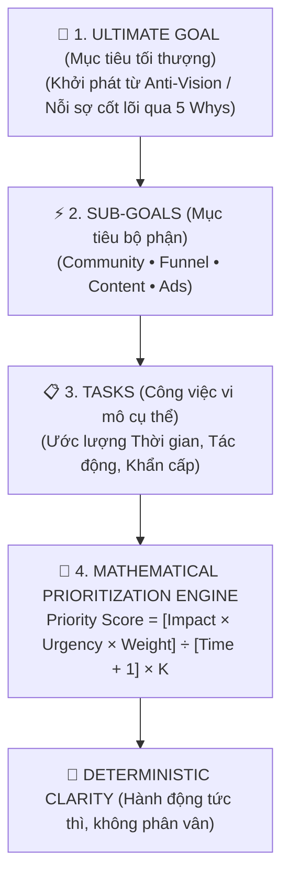
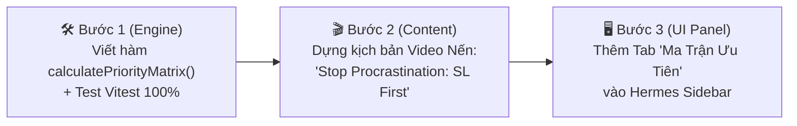

# SPEC & ARCHITECTURE DEBATE: Ứng Dụng Khung Toán Học Triệt Tiêu Trì Hoãn (G Russ Framework @ 4:39) Vào ChartAnimator & Kênh Azzam Gold

> **Nguồn tham chiếu:** Video YouTube `how to stop procrastination forever (FULL GUIDE)` — Tác giả: **g russ**  
> **Điểm neo trọng tâm (Timestamp):** `t=279s` (04:39) — *The Task Breakdown, Sub-goal Weighting & Mathematical Prioritization Engine*.  
> **Phạm vi ứng dụng:**  
> 1. **Trader Psychology & Video Content:** Chuyển hóa Anti-Vision & Ma trận triệt tiêu trì hoãn thành kịch bản video XAUUSD nến hoạt họa đánh trúng tâm lý người xem (PP-0039, PP-0023).  
> 2. **Hermes Production Orchestrator:** Tự động hóa thuật toán xếp hạng ưu tiên sản xuất cho kho 62 kịch bản của kênh `@azzammastertradinggold`, chấm dứt tình trạng "trì hoãn có năng suất" (productive procrastination) của đội ngũ.

---

## 1. BRAINSTORMING: MỔ XẺ BẢN CHẤT CỦA G RUSS FRAMEWORK (@ 4:39)

### 1.1. Bản chất cốt lõi của Video & Đoạn 04:39
Tại mốc **04:39**, G Russ đưa ra luận điểm mấu chốt để tiêu diệt sự trì hoãn:
- Con người trì hoãn **không phải vì lười biếng**, mà vì **thiếu sự rõ ràng tuyệt đối (Lack of Clarity)** và **mục tiêu quá mơ hồ**.
- Khi não bộ nhìn vào mục tiêu lớn (ví dụ: $10,000/tháng hoặc xây dựng kênh YouTube triệu view), nó bị ngợp và kích hoạt cơ chế tự vệ: **Productive Procrastination (Trì hoãn giả vờ bận rộn)** — ngồi dọn dẹp bàn làm việc, đổi màu giao diện Notion, kẻ bảng biểu, hoặc đọc thêm 1 cuốn sách PDF thay vì làm việc khó tạo ra tiền.
- Để thoát khỏi cái bẫy này, G Russ xây dựng cấu trúc 4 tầng phân rã ngược (Reverse Engineering):



### 1.2. Phân biệt then chốt giữa "Impact" (Tác động) và "Weight" (Trọng số)
Tại phút 5:50 - 6:30, G Russ vạch rõ ranh giới mà 99% mọi người nhầm lẫn:
- **`Impact` (Tác động nội bộ):** Là mức độ ảnh hưởng trực tiếp của 1 nhiệm vụ lên **Sub-goal** của chính nó. Ví dụ: Viết 1 kịch bản video có Hook giật gân có `Impact = 10` đối với Sub-goal "Phát triển Content", nhưng việc đổi avatar chỉ có `Impact = 2`.
- **`Weight` (Trọng số chiến lược):** Là tầm quan trọng của cả **Sub-goal đó** đối với **Ultimate Goal**. Ví dụ: Nếu mục tiêu tối thượng là doanh thu học viện Azzam Academy, thì Sub-goal "Xây dựng phễu Lead Magnet / Funnel" có `Weight = 9`, trong khi Sub-goal "Đổi nhạc nền B-Roll" chỉ có `Weight = 3`.

### 1.3. Áp dụng kép (Dual-Application) vào hệ sinh thái của chúng ta

| Góc độ áp dụng | Vấn đề hiện tại (Pain Point) | Giải pháp từ G Russ Framework |
| :--- | :--- | :--- |
| **A. Khán giả xem kênh (Retail Traders)** | Bị kẹt trong "Productive Procrastination": Đi săn 44 cuốn sách PDF, vẽ hàng tá chỉ báo RSI/MACD/Bollinger để trì hoãn việc **cắt lỗ $10-$30** và học cấu trúc giá cơ bản (PP-0039 & PP-0023). | **Kịch bản Video Anti-Vision:** Hermes dựng kịch bản biểu đồ nến phơi bày sự trì hoãn cắt lỗ là con đường dẫn tới cháy tài khoản $62k. Dùng công thức toán học để chứng minh: 1 cú click cắt lỗ ngay lập tức có `Priority Score` cao gấp 100 lần việc ngồi khấn nến hồi. |
| **B. Đội ngũ sản xuất (ChartAnimator & Team)** | Kho kịch bản có 62 bản (26 Long-form, 36 Shorts), 2,244 pain points nhưng team phân vân không biết dựng video nào trước, dẫn đến chậm tiến độ giờ vàng 00:00 VN. | **Hermes Dynamic Task Matrix:** Nhúng thẳng thuật toán `calculatePriorityScore()` vào ChartAnimator. Hermes tự động xếp hạng Top 1 video cần sản xuất ngay hôm nay dựa trên lượng comment, biến động giá Vàng thực tế, và thời gian dựng. |

---

## 2. THE TECHNICAL DEBATES (CUỘC TRANH LUẬN & PHẢN BIỆN ĐA CHIỀU)

### 2.1. Phản biện 1: Cái bẫy "Trì hoãn có năng suất" (Productive Procrastination Trap)
- **Luận điểm đối lập:** *"Nếu chúng ta bắt team hoặc khán giả phải mở bảng Excel ra ngồi chấm điểm Impact, Urgency, Weight, Time cho từng task, thì bản thân hành động ngồi chấm điểm đó chính là một dạng 'Productive Procrastination'! Thay vì làm video thì lại ngồi làm toán?"*
- **Lời giải kỹ thuật của Hermes:**
  - **Tự động hóa hoàn toàn (Zero Manual Calculation):** Người dùng KHÔNG phải tự nhập tay từng con số.
  - Hermes Agent tự động lấy dữ liệu:
    - `Impact`: Trích xuất từ số lượng comments khán giả thực tế (`channel-brain-v3.md` — ví dụ: PP-0023 có 488 comments $\rightarrow$ Impact = 9.8).
    - `Weight`: Trọng số phễu chuyển đổi khóa học (Khoá OPT-1, OPT-2 $\rightarrow$ Weight = 8.5).
    - `Urgency`: Tự động tính theo khoảng cách tới Giờ Vàng (00:00 VN).
    - `Time`: Đo lường bằng số giây hoạt họa nến (12 giây Shorts = 0.2 giờ).
  - Thuật toán tính toán ngầm dưới 5ms và xuất ra danh sách ưu tiên sẵn sàng với nút **[Dựng Ngay (1-Click)]**.

### 2.2. Phản biện 2: Mẫu số `Time + 1` và vai trò của hằng số chuẩn hóa `K`
- **Luận điểm toán học:** Tại sao lại là `Time + 1` mà không phải là `Time` thuần túy?
- **Chứng minh:**
  - Nếu task chỉ tốn 0 giờ hoặc vài phút (ví dụ: Duyệt 1 kịch bản = 0.1h), chia cho số thập phân gần 0 sẽ làm điểm số bùng nổ vô lý ($\infty$).
  - Thêm $+ 1$ đảm bảo hàm số luôn liên tục, mượt mà và phạt các tác vụ tốn quá nhiều thời gian (`Time` càng lớn, mẫu số càng to $\rightarrow$ `Priority Score` càng giảm).
  - Hằng số chuẩn hóa $K$:
    $$K = \frac{\text{Desired Max Score (100)}}{\text{Max Raw Score in Batch}}$$
    Giúp đưa toàn bộ điểm số về thang chuẩn $0 - 100$ trực quan, dễ hiểu cho mọi thành viên trong team.

---

## 3. CLEAN-ROOM SPECIFICATION (ĐẶC TẢ KỸ THUẬT)

### 3.1. Thuật toán Toán học (Mathematical Engine)

Cho tập hợp các công việc sản xuất nội dung $\mathcal{T} = \{t_1, t_2, \dots, t_n\}$, mỗi công việc $t_i$ có các thuộc tính:
- $I_i \in [1, 10]$: **Impact** — Mức độ tác động lên Sub-goal tương ứng (ví dụ: giải quyết nỗi đau lớn).
- $U_i \in [1, 10]$: **Urgency** — Tính cấp bách (ví dụ: bám sóng tin tức CPI/NFP hoặc sắp đến giờ đăng 00:00 VN).
- $W_i \in [1, 10]$: **Weight** — Trọng số của Sub-goal đối với mục tiêu tối thượng (doanh thu/reach của kênh).
- $T_i \in \mathbb{R}^+$: **Time (Hours)** — Thời gian dự kiến hoàn thành.

Công thức tính điểm ưu tiên thô (Raw Score):
$$R_i = \frac{I_i \times U_i \times W_i}{T_i + 1}$$

Hằng số chuẩn hóa $K$:
$$K = \frac{100}{\max_{j=1}^n (R_j)}$$

Điểm số ưu tiên cuối cùng (Final Priority Score):
$$P_i = \text{round}(R_i \times K, 1)$$

### 3.2. Data Model TypeScript (`src/types/prioritization.ts`)

```typescript
export interface SubGoal {
  id: string;
  name: 'Community' | 'Funnel' | 'Content' | 'Ads';
  weight: number; // 1 to 10: Tầm quan trọng đối với Ultimate Goal
  description: string;
}

export interface ProductionTask {
  id: string;
  title: string;
  subGoalId: string;
  impact: number;      // 1 to 10: Tác động lên Sub-goal
  urgency: number;     // 1 to 10: Độ cấp bách
  estimatedHours: number; // Thời gian thực hiện (giờ)
  rawScore?: number;
  priorityScore?: number;
  rank?: number;
  metadata?: {
    painPointId?: string;     // VD: 'PP-0023'
    commentCount?: number;    // VD: 488 comments
    strategy?: string;        // VD: 'Liquidity Sweep'
    scriptFile?: string;      // VD: 'script_2026-10-27_...md'
  };
}

export interface PrioritizationMatrixReport {
  timestamp: string;
  ultimateGoal: string; // VD: '100K Views & 100 Học Viên / Tháng'
  tasks: ProductionTask[];
  recommendedNextAction: ProductionTask;
}
```

### 3.3. API Endpoint (`src/app/api/hermes/prioritize/route.ts`)

- **Method:** `GET` / `POST`
- **Chức năng:** Đọc dữ liệu từ `C:\Users\Admin\youtube\channel-brain-v3.md` và `video_scripts/`, tính toán ma trận ưu tiên và trả về danh sách được xếp hạng từ cao xuống thấp.

---

## 4. ACTION PLAN: KẾ HOẠCH TRIỂN KHAI 3 BƯỚC



1. **Bước 1: Math Engine & Unit Test (`src/utils/procrastinationMath.ts`)**
   - Viết logic tính toán theo đúng công thức G Russ.
   - Viết test suite trong `tests/procrastinationMath.test.ts` đảm bảo tính toán tất định 100%.

2. **Bước 2: Kịch bản Video Triệt Tiêu Trì Hoãn cho Trader (`PP-0039 & Anti-Vision`)**
   - Tiêu đề Hook: **`TRÌ HOÃN CẮT LỖ, CHÁY TÀI KHOẢN!`**
   - Cốt truyện 4 bước:
     - *Hook (0-3s):* Bạn đọc 44 file PDF nhưng vẫn cháy $62k vì trì hoãn 1 việc duy nhất: Bấm dừng lỗ!
     - *Trap (3-6s):* Tâm lý hy vọng "nến sẽ quay đầu" chính là cái bẫy trì hoãn nguy hiểm nhất.
     - *Setup (6-9s):* Thay vì trì hoãn, đặt sẵn Stop Loss 20 pips tại vùng cản then chốt $4,128.00.
     - *Execution (9-12s):* Quản lý vốn Risk-First: Khóa chặt mức rủi ro $10/$30 trước khi nhìn biểu đồ.

3. **Bước 3: Hiển thị Ma Trận trên Giao Diện Web**
   - Tích hợp bảng ma trận trực quan vào Hermes Copilot để team biết chính xác video nào cần xuất bản tiếp theo.
