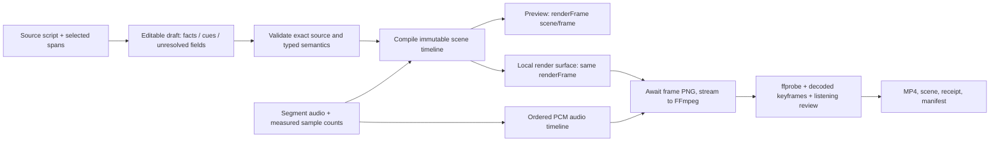

# SPEC — Script-to-video recovery v1

Date: 2026-11-04. ID: S2V-R1. Status: DESIGN_READY_FOR_REVIEW; implementation and media acceptance not performed.

User request: brainstorm, debate, plan and prepare a build specification after the script-to-video audit. This packet completes that documentation request. It does not claim human design approval, independent-agent design approval, or authorize sends/publishing.

## 1. Intent and scope

Make the local editor produce one narrated educational chart video whose visible events, prices, captions, audio and outcome match the selected script. The user's current pain is that script/API ingestion succeeds while rendered output is wrong. Success means a usable editor flow and inspected media, not more script integrations.

First vertical slice: import the exact excerpt in `script-to-video-pilot-v1.json`, inspect its seven narrative cues, attach/generate speech for those cues, preview, export and verify one 1080×1920/30 FPS narrated MP4. This is explicitly an excerpt, not the complete nine-minute source script. Preserve every selected word and original English language. Full-script multi-scene production, arbitrary video lengths, 16:9/1:1 acceptance, 60 FPS/4K, publication and WF22 wiring are later milestones.

The pilot narrates a planned BUY that hits its stop loss. Outcome MUST be STOP_LOSS. No TP rally, automatic win or minimum-RR requirement is applicable to this loss-budget lesson. Illustrative chart prices may be authored in an explicitly synthetic storyboard; they cannot be attributed to the source script or live market.

## 2. Baseline evidence and precedence

Read the 2026-11-04 deep audit, its 30-entry ledger and both offline probes in `livrables/test_reports/`. Baseline commit is `a7a63e5af22c32daddd31238aa34dac8ea567b59`; working tree has five pre-existing source/test modifications. Current renderer/test parse failures and independently verified ignored-input behavior are separate blockers. Existing 32 focused tests passing is not acceptance. [E1–E3]

Within this proposed recovery, precedence is: current user instruction; source text and explicit scene decisions; this spec; task plan; runtime/UI claims. Do not apply a default trading skill over a source's explicit outcome or monetary units. Numeric source claims remain source claims; this engineering spec does not certify their market truth.

Relationship to P3: P3 remains a historical planning-only specification for a silent 15-second 16:9 fixture and cross-repo bridge. S2V-R1 is a separate proposed local editor recovery scope. Do not silently claim P3, WF22, editor handoff or production readiness from S2V-R1. Borrow its identity/status/manifest discipline; do not import its profile or source-file prohibitions as requirements of this distinct repair. Build authorization, when supplied, must name S2V-R1 and the affected local files.

## 3. Selected architecture and boundaries



One scene compiler owns business semantics. One renderer owns visual semantics. Themes control style only. The current paper replica becomes an explicitly named reference preset; it must never override an imported scene. Existing math helpers may be reused when proven correct. React/Zustand own selection and editing, not frame capture timing.

Selected encoder path: deterministic Canvas frame stepping plus FFmpeg image2pipe, then audio mux. Sequential awaited browser evaluation and writable-stream backpressure prevent unbounded frame queues. MediaRecorder does not produce accepted S2V output; WebCodecs is deferred until an equivalent output contract can be independently proven.

Local-only deployment: installed browser, Node supervisor and FFmpeg are required. This is not a serverless/Vercel renderer. Show a truthful unsupported-environment message when local capability is absent. No silent cloud job/provider fallback.

## 4. Canonical input, draft and scene contracts

Future modules and signatures are defined here; they are not implemented by this document.

```ts
type Direction = 'BUY' | 'SELL';
type Outcome = 'STOP_LOSS' | 'TAKE_PROFIT' | 'OPEN' | 'NO_TRADE';
type Span = { startUtf16: number; endUtf16: number }; // half-open in selectedText

type SourceDocument = {
  id: string; revision: number; sourceSha256: string;
  selection: 'FULL' | 'EXCERPT'; selectedText: string; selectedTextSha256: string;
  language: 'en' | 'vi';
};
type Issue = { code: string; path: string; message: string; severity: 'error' | 'warning' };
type Result<T> = { ok: true; value: T; issues: Issue[] } |
                 { ok: false; issues: Issue[] };
type AudioReceipt = {
  assetId: string; sha256: string; transcriptSha256: string;
  sampleRate: 48000; channels: 1; sampleCount: number;
  origin: 'USER_UPLOAD' | 'TTS'; review: 'UNREVIEWED' | 'MATCHED' | 'REJECTED';
};
type NarrationCue = {
  id: string; intentId: string; span: Span; text: string; audio: AudioReceipt | null;
};
type Candle = { id: string; index: number; open: number; high: number; low: number; close: number };
type Budget = { riskUsd: number; slPips: number; usdPerPip: number };
type Order = { direction: Direction; entry: number; sl: number; tp: number | null };
type Gap = { id: string; kind: 'FVG'; candleIds: [string, string, string]; low: number; high: number };
type Overlay = Gap | { id: string; kind: 'LEVEL'; price: number; label: string };
type CueAction =
  | { kind: 'REVEAL_CANDLES'; candleIds: string[] }
  | { kind: 'SHOW_OVERLAY'; overlayId: string }
  | { kind: 'SHOW_TEXT'; id: string; text: string }
  | { kind: 'SHOW_BUDGET' }
  | { kind: 'MARK_OUTCOME'; outcome: Outcome };
type StoryboardCue = { intentId: string; actions: CueAction[] };
type SceneDraft = {
  schema: 'scene-draft/1'; source: SourceDocument;
  truthClass: 'EDUCATIONAL_ILLUSTRATION'; language: 'en' | 'vi';
  direction: Direction | null; outcome: Outcome;
  candles: Candle[]; overlays: Overlay[]; budget: Budget | null; order: Order | null;
  chartPriceOrigin: 'SYNTHETIC' | 'SOURCE';
  entryBasis: 'NONE' | 'EXPLICIT' | 'FVG_CE'; entryOverlayId: string | null;
  narration: NarrationCue[]; storyboard: StoryboardCue[];
  profile: { width: 1080; height: 1920; fps: 30; maxDurationSec: 120 };
  theme: 'paper' | 'dark' | 'white';
};
type ScheduledCue = {
  id: string; text: string; startSample: number; endSample: number;
  startFrame: number; endFrame: number; audioAssetId: string;
};
type TimedAction = { frame: number; action: CueAction };
type FrozenScene = {
  schema: 'frozen-scene/1'; sceneSha256: string; draftSha256: string;
  draft: Readonly<SceneDraft>; cues: ScheduledCue[]; events: TimedAction[];
  frameCount: number; audioSampleCount: number;
  watermark: 'EDUCATIONAL ILLUSTRATION — NOT FINANCIAL ADVICE';
};
type FrameReceipt = { frame: number; sceneSha256: string; visibleIds: string[];
  bounds: { id: string; x: number; y: number; width: number; height: number }[] };
```

`compileScene(draft: SceneDraft): Result<FrozenScene>` is pure. It never fetches, generates speech, guesses an order, replaces captions or rewrites source. Runtime validator rejects unknown fields, NaN/Infinity, oversized inputs and inconsistent references. Hash canonical JSON with sorted object keys, preserve array order, UTF-8 and exact text; omit only `sceneSha256` from its own digest. Source file byte hash differs deliberately from selected-text UTF-8 hash. JSON whitespace must not change semantic scene hash.

`renderFrame(ctx, scene, frameIndex): FrameReceipt` is synchronous after assets/fonts are ready. Frame index must be an integer in [0,N). No Date.now, unseeded randomness, store reads, asynchronous paint side effects or font fetching inside it. Use explicit immutable theme tokens, one fixed profile and one coordinate transform.

`applyDraft(draft)` atomically replaces the active draft, invalidates scene/validation/audio references whose text hashes changed, and resets playback. `freezeForExport(revision)` compiles and returns an immutable snapshot only if all mandatory checks pass. A later edit cannot mutate a running job. Deep-copy and recursively freeze nested arrays/objects at snapshot creation; TypeScript Readonly alone is not a runtime isolation mechanism.

## 5. Script import, units and unresolved input

All entry paths converge on `SceneDraft`: BriefImporter native/manual/AI, Hermes chat modal/sidebar, registry selection and AzzamOps/template selection. Components may propose draft fields but must not call ad hoc addCandle/setExecutionOrder during import. AI results are untrusted draft proposals, never runtime truth.

Supported MVP import is the checked-in pilot source excerpt and a structured editable storyboard. Freeform script import preserves original text and suggests segments; unsupported/ambiguous values enter NEEDS_REVIEW with field-level messages. No claim that arbitrary prose automatically becomes correct cinematography. User can confirm narration and scene cues in one review screen. Do not silently select newest script, truncate to four lines, translate, or force 12 seconds.

Unit rules:
- Budget: usdPerPip = riskUsd / slPips. Pilot: 30/20=1.5 USD/pip.
- Lot is not inferred or displayed for this pilot. A future lot field requires explicit instrument contract size, pip size and currency conversion; strings such as '$1.50/pip' cannot be parsed as lots.
- Missing source entry/TP stays absent. Synthetic geometry is labeled illustration. The pilot's order is null, entryBasis=NONE, entryOverlayId=null, and lesson overlays show budget mechanics; no trade signal card.
- For separate strategy fixtures with order data, validate BUY TP>entry>SL and SELL SL>entry>TP when TP exists. Outcome does not have to be profitable.
- FVG bounds derive from the referenced three candles. When entryBasis=FVG_CE, entryOverlayId must resolve to that FVG, order must exist, and entry=(low+high)/2 within 1e-8 numerical tolerance. All displays reference that same value.
- R:R derives from order distances when TP exists; labels never specify independent RR. Loss-budget lessons have no minimum-RR gate.

## 6. Narration and deterministic time

The seven pilot segments are exact contiguous source spans, including whitespace. Concatenating them must equal selectedText byte-for-byte in UTF-8. Display wrapping may change line breaks only; narrated wording cannot change.

Two asset paths: user uploads one WAV per segment, or explicitly invokes existing TTS for each exact segment. Offline acceptance must work with prerecorded speech and must not require paid/provider calls. TTS is not automatically called by import or validation. Existing provider failures surface as AUDIO_MISSING; Web Speech may offer preview but cannot satisfy export audio requirements.

Decode/resample each segment to mono PCM 48kHz. For each measured segment length L_i samples, allocate K_i=ceil(L_i/1600) frames at 30fps. Pad only the trailing fractional frame with silence; no speech trim or speed change. StartSample_i=1600*sum(K_j before i), endSample_i=startSample_i+L_i. Cue interval uses startFrame=sum(K_j before i), endFrame=startFrame+K_i (exclusive). N=sum K_i; assembled WAV length=N*1600 samples. Reject total duration outside (0,120] seconds rather than compressing it.

Split long narration segments into consecutive source spans using sentence boundaries when captions do not fit; preserve complete text/order and retain cue/action association. This is a visible draft edit that requires audio regeneration/rebinding. Never silently shrink text below the minimum readable size to fit.

Each narration segment has an intentId. Splitting it preserves that intentId; intent groups must stay contiguous. Storyboard contains exactly one entry per intentId. Its actions occur at the first frame of that intent group; its reveal interval ends at the last segment of that group. MVP storyboard actions occur at that group startFrame. Reveal multiple candles evenly across that cue's frame interval, preserving chronological index order; no action references a future candle before its reveal. The stop-hit cue must reveal the adverse movement and mark STOP_LOSS; no later target-win action is allowed. More precise word-timed events require user-specified aligned subsegments, not guessed timestamps.

Audio response assignment uses `(sourceId,revision,cueId,transcriptSha256)` captured before request. If any member differs on completion, discard response; never attach old audio to a new script. Audio review MATCHED is recorded only after a human listens against exact text or a separately validated transcript comparison; hash alone proves binding, not spoken correctness.

## 7. Render, layout and preview

Themes consume the identical FrozenScene and FrameReceipt semantics; no hardcoded candle arrays, entry prices or timeline events. Watermark is renderer policy, immutable on every frame.

MVP 1080×1920 profile: safe horizontal bounds x=72..936, vertical bounds y=160..1600. Allocate headline y=160..340, chart y=390..1160, teaching/budget y=1190..1330, caption y=1360..1510, watermark y=1540..1600. Text min 28px for watermark/labels and 40px for narration; measure with actual loaded font. More than three caption lines produces CAPTION_OVERFLOW; split source cue before freeze. Overlap among reserved zones or clipping outside them is a hard failure. These are internal conservative pilot margins, not a claim of permanent platform UI safe zones.

Use bundled versioned fonts and no external render-time assets. Preview may CSS-scale the fixed canvas, but its backing dimensions remain profile dimensions. NLE width/position derives from scheduled frames, not equal-width blocks. Audio is the master preview clock; seek maps currentTime to floor(time*30), clamped to [0,N-1]. Pause/seek cancels pending playback correctly. Non-audio draft preview must be visibly labeled draft, not export-ready.

Render readiness waits for document.fonts.ready and verified asset availability before accepting frame 0. Dedicated render canvas ID: `chart-render-canvas`. Export never queries the first arbitrary canvas.

## 8. Local media pipeline and usable editor export

Editor flow: import → review exact text/cues → resolve draft errors → attach or generate narration → preview → Export → progress → download verified MP4 / review keyframes. Export cannot report full visual acceptance automatically; show MEDIA_VERIFIED followed by a human visual/listening review state.

Proposed local browser bridge at `/render` exposes only `loadScene(scene)`, `renderFrame(index)`, `getStatus()`, `cancel()` under `window.chartAnimatorBridge`. It accepts validated objects over the supervisor's page.evaluate call, never filesystem paths in URLs. renderFrame returns PNG bytes/data plus FrameReceipt after synchronous drawing.

Node supervisor streams one PNG at a time to FFmpeg stdin. Await frame acknowledgement and writable drain before requesting the next. Enforce sequence 0..N-1 with no missing/duplicate/out-of-order indices. Use stream hashes and ordered frame receipt log; retain PNG only for cue boundaries, one middle frame per cue and final frame. Do not store a full frame directory by default.

FFmpeg invocation is an argument array (shell=false); equivalent command shape:

```text
ffmpeg -hide_banner -nostdin -f image2pipe -framerate 30 -vcodec png -i pipe:0
  -i narration.wav -map 0:v:0 -map 1:a:0 -c:v libx264 -preset medium -crf 18
  -pix_fmt yuv420p -fps_mode cfr -c:a aac -ar 48000 -b:a 192k
  -movflags +faststart output.partial.mp4
```

Close frame input only after exactly N receipts. Audio WAV has already been padded to N/30; do not use `-shortest` to hide truncation. Validate actual output then rename atomically to output.mp4. Commands are proposed build behavior, not executed in this documentation task. Local `ffmpeg -h demuxer=image2pipe` and `-h encoder=libx264` confirmed those installed capabilities; pin binary version/hash in each render manifest. [E4]

Local job routes: POST `/api/render/jobs`, GET `/api/render/jobs/{id}`, DELETE `/api/render/jobs/{id}`, GET `/api/render/jobs/{id}/artifact`; asset import POST `/api/render/assets`. They delegate to one Node job runner. The CLI submits and polls these same loopback job routes; it does not import TypeScript server files directly or introduce a second runner. Local runner enabled only for explicit loopback studio mode; reject invalid Host/Origin, cross-origin calls and missing per-session anti-CSRF token. Bind server 127.0.0.1, no public tunnel integration. IDs are server-generated, paths resolved beneath a configured output root; never accept arbitrary source/output path or URLs. Job launch uses spawn with validated arguments and no shell. One active job, 409 for second submission; 1MB scene JSON, 100MB audio file limit; no arbitrary process API. Test all negative boundaries.

Asset bytes are stored by content hash in a confined local asset store. Scene references an asset ID and hash, not a client filesystem path. Reads and downloads are confined to the same session. Supported audio upload for MVP: WAV only, validate decoded format/duration using ffprobe; reject traversal, malformed files and excess size. API job endpoints do not call external services.

State machine: DRAFT → NEEDS_REVIEW or VALIDATED → AUDIO_READY → FROZEN → RENDERING → MEDIA_VERIFIED → REVIEW_ACCEPTED. Job failures are terminal FAILED/CANCELLED/TIMED_OUT; exactly one terminal receipt. Human review rejection yields REVIEW_REJECTED without deleting media. Changed source requires a new revision/job.

Operational limits: 120s startup/readiness, 30s per frame hard timeout, 30 minutes total job cap, 120s mux/probe cap within total; stop on missing binary/browser/font/audio. Preflight at least 3GiB free on each temp/output volume plus a conservative per-job estimate; estimate 1GiB output allowance + 2×audio + 64MiB buffers, require remaining 1GiB reserve. These are S2V streaming-job limits, not a statement that historical P3 disk conditions are resolved. Cap RSS 1.5GiB per worker and pending PNG queue at two frames; resource exhaustion fails cleanly. Cancel kills/reaps only owned browser/encoder processes and preserves diagnostic receipts. No recursive delete of existing outputs; cleanup is separately scoped.

## 9. Gates and evidence

JEV becomes an explicit structured validation result with error severity; no hardcoded visual gate and no automatic semantic rewrite. Core semantic validator lives at the scene boundary; a JEV UI label is a view of its results. Runtime layout and media checks remain separate evidence classes. Existing numeric scores may remain advisory, but any mandatory error blocks freeze/export.

Acceptance IDs:

| ID | Required evidence |
|---|---|
| A01 | Pilot source byte hash and exact excerpt/segment concatenation match; no canned text |
| A02 | Invalid OHLC anywhere, NaN, conflicting direction, wrong CE, unit ambiguity reject before freeze |
| A03 | Pilot direction BUY, outcome STOP_LOSS, budget30/SL20/USD-per-pip1.5; no lot/TP invented |
| A04 | Empty vs altered candles changes expected chart region; same scene renders identically for all retries in pinned environment |
| A05 | All three themes preserve scene semantics; paper does not use replica candles |
| A06 | Every action/caption/audio follows cue schedule; stale revision audio discarded |
| A07 | Every frame has watermark, valid bounds, no reserved-zone overlap; actual raster review at cue boundaries |
| A08 | UI user can import/review/attach audio/preview/export/download without a developer manually altering store |
| A09 | ffprobe counted decoded frames=N, resolution1080×1920, avg/r frame rate30/1, H.264/yuv420p; video duration within one frame of N/30 |
| A10 | AAC 48kHz audio exists; A/V start difference≤50ms, end difference≤100ms accounting for codec padding; human listens all selected text, no missing/cut words |
| A11 | Full decode returns no errors; decoded keyframes visually match preview and scene expectations; fixed-environment raw PNG repeat hashes equal |
| A12 | Invert coordinate, corrupt OHLC, omit frame each cause the corresponding gate to FAIL, with baseline passing and isolated mutations restored |
| A13 | Additional ignored-input and wrong-audio-revision mutations fail; these are not replaced by self-contained broken helpers |
| A14 | Cancel/timeout/encoder failure produces one failure receipt, no success download or orphan process |
| A15 | No external API/send/publish during offline acceptance; access/path/origin negatives fail |
| A16 | Independent reviewer checks source→scene→keyframes→audio→file evidence and returns explicit reasons, not a score alone |

Frame count cannot alone detect a duplicated frame substituted for another. Compare the ordered FrameReceipt log with actual submitted hashes and decode selected frames around every narrative transition. The missing-frame mutation must omit a transport write while preserving the intended N; verify encoder media count N-1 makes A09 fail. Pixel evidence must include independent expected-region assertions, not snapshots generated and approved by the same code.

First accepted run produces: input.source.json, draft.json, frozen-scene.json, narration.wav, frame-receipts.jsonl, keyframes/, output.mp4, ffprobe.json, manifest.json, visual-audio-review.md, stdout/stderr logs. Manifest binds source/excerpt/draft/scene/audio/output hashes, renderer dirty snapshot, binary/browser/font versions, profile, failures and externalActions=NONE. No source secrets or account tokens in artifacts.

## 10. Build roles and migration

Orchestrator freezes scope/source and verifies evidence. Builder reads this spec, plan and owned code only. Media verifier examines output independently. QA introduces isolated mutations, reviews source fidelity and rejects false PASS. If reviewer unavailable, stop at IMPLEMENTED_PENDING_REVIEW; never replace independent approval with builder confidence.

Migrate internal ownership in bounded tasks: repair dirty baseline; add scene contract; route importer pilot; implement canonical renderer and audio; implement local media runner; expose editor job flow; migrate remaining input paths. During transition, legacy paths must visibly be legacy/draft-only and cannot reach the verified export path. At closure every enabled production input path uses the canonical adapter or is explicitly unavailable, never silently half-supported.

Keep existing user scripts, reference assets and unrelated source untouched. Retire duplicate execution logic by responsibility after its adapter tests pass, not by deleting all legacy components. No new skill pack, extra permanent agents, REA installation, cross-repo writes or WF22 edits are needed for this milestone.

## Evidence references

[E1] `../test_reports/script_to_video_audit_2026-11-04.md` and `script_to_video_ledger_2026-11-04.json`: source excerpts with baseline Git SHA and exact working-tree file hashes.
[E2] `../test_reports/script_render_probe_2026-11-04.json`: reproduced validator/parser/JEV contradictions.
[E3] `../test_reports/probe_head_paper_renderer.result.json`: equal frame-command traces for different geometry at pinned HEAD; not browser pixel acceptance.
[E4] Read-only capability checks performed in this planning turn: ffmpeg image2pipe and libx264 help exited0. Browser scripting API reference consulted: https://playwright.dev/docs/api/class-page#page-evaluate. New dependency version selection and installed-browser launch remain build preflight work, not verified here.

