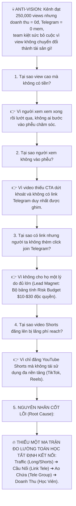
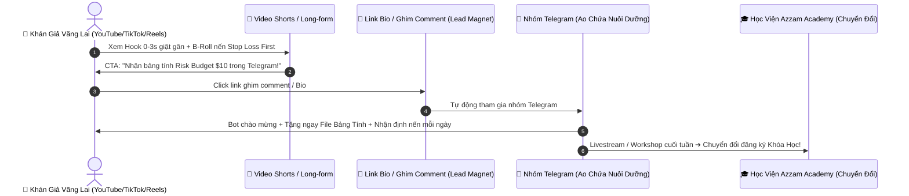

# CHIẾN LƯỢC PHÂN RÃ MỤC TIÊU & MA TRẬN TOÁN HỌC G RUSS (@ 04:39) CHO HỆ SINH THÁI YOUTUBE @AZZAMMASTERTRADINGGOLD

> **Căn cứ phương pháp luận:** Khung kỹ thuật phân rã ngược (Reverse-Engineering Framework) & Ma trận toán học triệt tiêu trì hoãn của **g russ** (*how to stop procrastination forever @ 04:39*).  
> **Áp dụng trực tiếp vào:** Dự án YouTube `@azzammastertradinggold` + Hệ sinh thái Video Shorts Đa Nền Tảng (TikTok/Reels/Shorts) + Phễu Chuyển Đổi Telegram + Học Viện Azzam Academy.  
> **Nguyên tắc cốt lõi:** **KHÔNG BUILD CODE** — Tập trung 100% vào Tư Duy Chiến Lược, Bảng Chỉ Số Định Lượng, Ma Trận Toán Học Tất Định và Tranh Luận Phản Biện Đa Chiều.

---

## PHẦN 1: BRAINSTORMING — THIẾT KẾ CỖ MÁY REVERSE-ENGINEERING CHO KÊNH

### 1.1. Khởi nguồn từ Anti-Vision & 5 Whys (Nỗi đau thúc đẩy hành động)
Theo G Russ, mục tiêu không bắt đầu từ một "giấc mơ màu hồng" (Dream Outcome), mà bắt đầu từ **Anti-Vision (Bức tranh tồi tệ nhất cần phải tránh bằng mọi giá)**.

---

### 1.2. Phân rã 4 Tầng Mục Tiêu (The 4-Tier Hierarchy)

#### 🎯 TẦNG 1: ULTIMATE GOAL (Mục tiêu tối thượng 30 ngày)
> **"Xây dựng cỗ máy phễu tạo ra $3,000 – $5,000 Doanh thu/tháng từ 30 – 50 Học Viên Azzam Academy, nuôi dưỡng bởi 1,000 Thành viên chất lượng trong nhóm Telegram từ mạng lưới 250,000 Views Video Long & Short đa nền tảng."**

#### ⚡ TẦNG 2: 4 SUB-GOALS (Mục tiêu bộ phận cấu thành)
1. **Sub-Goal A (Traffic Multi-Platform - Trọng số $W = 9.0$):**
   - Đạt **200,000 views Shorts đa nền tảng** (YouTube Shorts, TikTok, Facebook Reels) + **50,000 views Long-form Evergreen** (YouTube 5-8 phút).
2. **Sub-Goal B (Bridge & Lead Capture - Trọng số $W = 9.5$):**
   - Đạt tỷ lệ nhấp link (Click-Through-Rate to Tele) **$\ge 2.5\%$**, kéo tối thiểu **1,000 members thực** vào nhóm Telegram thông qua Lead Magnet độc quyền (Bảng tính Risk Budget $10/20 pips SL).
3. **Sub-Goal C (Telegram Community Nurture - Trọng số $W = 8.5$):**
   - Duy trì tỷ lệ tương tác (Engagement Rate) trong Telegram **$\ge 25\%$**, giải đáp cấu trúc nến XAUUSD thực chiến mỗi ngày, loại bỏ 100% spam/bot.
4. **Sub-Goal D (Conversion to Academy - Trọng số $W = 10.0$):**
   - Chuyển đổi **3% – 5%** thành viên Telegram đăng ký các khóa học thực chiến (OPT 1 - OPT 11 trên learn.azzamedu.com) với doanh thu trung bình \$100/học viên.

---

## PHẦN 2: PLAN — KẾ HOẠCH HÀNH ĐỘNG 30 NGÀY & BỘ CHỈ SỐ ĐỊNH LƯỢNG

### Lộ trình 3 Giai đoạn cụ thể (30-Day Execution Roadmap):

| Giai đoạn | Thời gian | Mục tiêu trọng tâm | Chỉ số đo lường (KPI) |
| :--- | :--- | :--- | :--- |
| **Pha 1: Đóng Cọc Hạ Tầng Phễu** | Ngày 1 – Ngày 7 | - Chuẩn hóa 1 Link Telegram duy nhất. - Tạo Lead Magnet: File Excel/Notion *Risk Budget Calculator $10/$30*. - Thiết lập tin nhắn chào mừng tự động phát tài liệu khi mem mới join. | - 1 link duy nhất trên mọi Bio. - File Lead Magnet hoàn thiện 100%. - Tỷ lệ gửi quà tự động: 100%. |
| **Pha 2: Bắn Phá Đa Nền Tảng** | Ngày 8 – Ngày 21 | - Xuất bản 3 – 4 Long-form Evergreen/tuần trên YouTube. - Dùng ChartAnimator cắt 12 – 15 Shorts/tuần đăng đồng thời: YouTube Shorts, TikTok, FB Reels. - Ghim comment có link Tele ở 100% video. | - 15 Shorts x 3 nền tảng = 45 bài đăng. - 200,000 views tổng hợp. - 500 mem mới vào Telegram. |
| **Pha 3: Kích Hoạt Chuyển Đổi** | Ngày 22 – Ngày 30 | - Tổ chức 2 buổi Live Review kịch bản nến thực chiến trong nhóm Telegram. - Chia sẻ Case Study học viên áp dụng quy tắc $10 rủi ro thành công. - Mở cổng đăng ký học viện Azzam Academy với ưu đãi có hạn. | - 1,000 mem Telegram tích lũy. - 30 – 50 học viên đăng ký mới. - **$3,000 – $5,000 doanh thu**. |

---

## PHẦN 3: SPEC — BẢNG MA TRẬN TOÁN HỌC G RUSS (@ 04:39) CHO DỰ ÁN YOUTUBE

Áp dụng đúng công thức toán học từ video mẫu tại phút **07:30**:
$$\text{Raw Priority Score} = \frac{\text{Impact} \times \text{Urgency} \times \text{Weight}}{\text{Time (Hours)} + 1}$$
$$\text{Final Priority Score} = \left(\frac{\text{Raw Score}}{\text{Max Raw Score}}\right) \times 100$$

- **`Weight` (1-10):** Tầm quan trọng của Sub-goal đối với Doanh thu & Kênh.
- **`Impact` (1-10):** Tác động trực tiếp của Task lên Sub-goal của nó.
- **`Urgency` (1-10):** Mức độ cấp bách (càng để lâu càng mất tiền/view).
- **`Time` (Hours):** Thời gian thực tế để hoàn thành task.

### BẢNG XẾP HẠNG NHIỆM VỤ CHI TIẾT THEO CÔNG THỨC TOÁN HỌC:

| Hạng (Rank) | Sub-Goal | Tên Nhiệm Vụ Cụ Thể (Task Description) | Thời Gian (T - Giờ) | Impact (I: 1-10) | Urgency (U: 1-10) | Weight (W: 1-10) | Điểm Thô (Raw Score) | Điểm Chuẩn Hóa (Priority: 0-100) | Hành Động |
| :---: | :--- | :--- | :---: | :---: | :---: | :---: | :---: | :---: | :--- |
| **🥇 1** | **B. Bridge (Tele)** | **Ghim Comment & Cập nhật 1 Link Tele duy nhất kèm quà tặng lên toàn bộ video cũ & mới** | **0.5h** | **10** | **10** | **9.5** | **633.3** | **100.0** | 🔥 **LÀM NGAY HÔM NAY** |
| **🥈 2** | **B. Bridge (Tele)** | **Đóng gói Lead Magnet mồi nhử: "Bảng tính Quản Lý Vốn Risk $10 / 20p SL cho Vàng"** | **2.0h** | **10** | **9** | **9.5** | **285.0** | **45.0** | ⚡ **LÀM TRONG 24H** |
| **🥉 3** | **A. Multi-Traffic** | **Dựng & Xuất 6 Shorts nến từ ChartAnimator đăng đồng thời YouTube Shorts + TikTok + Reels** | **2.5h** | **9** | **9** | **9.0** | **208.3** | **32.9** | ⚡ **NHỊP HÀNG NGÀY** |
| **4** | **D. Conversion** | **Tạo Landing Page / Offer đơn giản giới thiệu Khóa học Azzam Academy (OPT 1 - OPT 11)** | **3.0h** | **9** | **8** | **10.0** | **180.0** | **28.4** | 🎯 Tuần 1 |
| **5** | **C. Community** | **Cài đặt Bot Telegram tự động gửi quà tặng ngay khi có người bấm Start vào nhóm** | **1.0h** | **8** | **8** | **8.5** | **272.0** | **42.9** | ⚡ Làm ngay sau Task 2 |
| **6** | **A. Multi-Traffic** | **Sản xuất 1 Video Long-form Evergreen 8 phút chủ đề: "30-Day XAUUSD Roadmap"** | **6.0h** | **9** | **7** | **9.0** | **81.0** | **12.8** | 🎯 Nhịp 3 video/tuần |
| **7** | **C. Community** | **Tổ chức 1 buổi Mini-Livestream 30p trong Telegram mổ xẻ bẫy quét thanh khoản phiên Mỹ** | **1.0h** | **8** | **6** | **8.5** | **204.0** | **32.2** | 🎯 Cuối tuần |
| **8** | **D. Conversion** | **Viết kịch bản 3 bài Post Nurture trong Telegram: Bóc phốt bẫy săn PDF 44 cuốn sách** | **1.5h** | **7** | **6** | **10.0** | **168.0** | **26.5** | 🎯 Tuần 2 |
| **9** | **A. Multi-Traffic** | **Tối ưu SEO bộ thẻ Tag, Title kịch bản bám sát từ khóa "XAUUSD Trading for Beginners"** | **1.0h** | **6** | **5** | **9.0** | **135.0** | **21.3** | 🎯 Tuần 2 |
| **❌ 10** | *Thừa thãi* | *Ngồi đổi màu logo kênh, thiết kế lại banner 3D, đổi font chữ ảnh bìa Notion* | **8.0h** | **2** | **1** | **3.0** | **0.67** | **0.1** | 🚫 **TRIỆT TIÊU (Trì hoãn)** |

> [!IMPORTANT]
> **Nhìn vào bảng toán học:** Task số 1 (Ghim link Telegram vào toàn bộ video) chỉ tốn **0.5 giờ** nhưng có điểm ưu tiên tuyệt đối **100.0 điểm**, trong khi việc ngồi đổi logo hay sửa lặt vặt tốn 8 tiếng chỉ đạt **0.1 điểm**! Đây chính là bằng chứng toán học đập tan sự trì hoãn mà video G Russ đã chứng minh.

---

## PHẦN 4: DEBATES — 5 CUỘC TRANH LUẬN & PHẢN BIỆN CHIẾN LƯỢC SÂU SẮC

### 🥊 Tranh luận 1: "Shorts đa nền tảng kéo view nhanh, nhưng mem Telegram từ TikTok có phải là 'traffic rác' không?"
- **Phản biện tiêu cực:** *"Người xem TikTok/Reels chỉ xem giải trí lướt qua trong 3 giây, kéo họ vào Telegram họ chỉ vào hóng kèo rồi out, không bao giờ mua khóa học đâu!"*
- **Lập luận chiến lược của Hermes:**
  - **Sự thật:** Traffic TikTok chỉ "rác" nếu bạn làm video kiểu khoe tiền, nhảy múa, hoặc giật gân rẻ tiền.
  - **Khác biệt của kênh Azzam:** Video của chúng ta được dựng từ ChartAnimator với nội dung **Risk-First cực kỳ nghiêm túc**: Cảnh báo cháy tài khoản, kỷ luật $10 rủi ro, bóc mẽ bẫy quét thanh khoản.
  - Người xem TikTok mà dám bấm vào Bio link, vượt qua bước cài đặt Telegram để vào nhóm nhận file bảng tính quản lý vốn thì **90% họ là retail trader đang thua lỗ nặng và cực kỳ khát khao phương pháp đúng đắn**. Đây chính là tệp khách hàng tiềm năng nóng nhất của học viện!

---

### 🥊 Tranh luận 2: "Thả link Telegram ở đâu để KHÔNG bị TikTok / YouTube bóp tương tác (Shadowban)?"
- **Nỗi sợ:** Nền tảng nào cũng muốn giữ chân người dùng trong ứng dụng của họ; nếu dẫn link ngoài app (External URL) sẽ bị bóp reach!
- **Chiến thuật luồn lách thông minh:**
  1. **Trên TikTok / Facebook Reels:**
     - Tuyệt đối KHÔNG viết chữ "Telegram" lộ liễu trong caption hay trên video (thuật toán AI quét OCR sẽ bóp).
     - **Giải pháp:** Trong video nói: *"Nhận bảng tính quản lý vốn tại link đầu trang (Bio)"*. Trên Bio gắn 1 link trung gian sạch (Linktree / trang landing tối giản) dẫn thẳng vào Telegram.
  2. **Trên YouTube (Shorts & Long):**
     - YouTube cho phép ghim comment. Đặt cú pháp chuẩn:
       > 🎁 *Tải Bảng Tính Risk Budget $10 & Nhận định nến hôm nay tại nhóm thảo luận:* `https://t.me/...`
     - Ghim comment lên đầu trang và bấm Tim comment đó.

---

### 🥊 Tranh luận 3: "Thả link thẳng vào Nhóm Chat Telegram hay qua Trang Landing Page tặng tài liệu?"
- **Trường phái A (Direct Link):** Thả thẳng link `t.me/youttubegroup` cho tiện, đỡ mất công bấm nhiều lần.
- **Trường phái B (Lead Magnet Squeeze Page):** Dẫn qua 1 trang web 1 màn hình bắt điền Email/Tên rồi mới hiện link Telegram.
- **Phán quyết của Hermes:**
  - **Chọn Trường phái A cải tiến (Direct + Bot Delivery):**
    - Người xem Short lướt trên điện thoại có độ tập trung rất ngắn. Nếu bắt họ điền form email, tỷ lệ rớt khách (Drop-off rate) lên tới **70%**.
    - Cho họ bấm thẳng vào Telegram. Khi họ vào, con bot `@Youtube7979bot` lập tức gửi tặng file tài liệu qua tin nhắn riêng. Cách này vừa có thành viên trong nhóm, vừa có quyền nhắn tin trực tiếp để sau này chăm sóc!

---

### 🥊 Tranh luận 4: "Video Long-form ít view hơn Shorts, có nên bỏ Long-form để dồn 100% sức làm Shorts không?"
- **Cám dỗ:** Shorts được 10,000 – 50,000 view dễ dàng, còn Long-form chỉ được 300 – 1,000 view, sao không bỏ Long-form cho đỡ mệt?
- **Phản biện sống còn:**
  - **Shorts là "Mũi Giáo" (Top of Funnel - Traffic):** Thu hút người mới biết tới thương hiệu. Nhưng Short 60 giây không đủ thời gian xây dựng sự tin tưởng sâu sắc.
  - **Long-form là "Cỗ Máy In Tiền" (Bottom of Funnel - Conversion):** Khán giả ngồi xem 8 phút phân tích cấu trúc nến và quản lý vốn của Alan sẽ coi Alan là **Chuyên gia thực thụ**. 1 view Long-form có giá trị chuyển đổi gấp **50 lần** 1 view Shorts!
  - **Tỷ lệ vàng:** Dùng ChartAnimator làm 4 Shorts/tuần (đăng đa nền tảng) để hút 80% traffic, nhưng bắt buộc phải có 2 Long-form/tuần để chuyển hóa traffic đó thành người mua khóa học.

---

### 🥊 Tranh luận 5: "Triệt tiêu cái bẫy 'Productive Procrastination' lớn nhất của Team là gì?"
- **Cái bẫy thật sự của team:**
  - Team hay ngồi tranh cãi: *"Cây nến này xanh hay đỏ?", "Chỉnh lại màu giao diện app cho đẹp hơn?", "Sửa font chữ trên thumbnail?"*... và mất hàng tuần trời nhưng không xuất bản được video nào, không kéo được ai vào Telegram.
- **Quy tắc kỷ luật sắt:**
  - Theo bảng toán học ở Phần 3, **tất cả các việc lặt vặt có Priority Score < 10 điểm BẮT BUỘC BỊ ĐÌNH CHỈ**.
  - Mỗi ngày chỉ tập trung vào 2 chỉ số duy nhất:
    1. **Bao nhiêu Shorts/Long đã được xuất bản và ghim link?**
    2. **Hôm nay có bao nhiêu thành viên mới tham gia vào Telegram?**
  - Mọi tranh cãi ngoài 2 chỉ số này đều bị coi là **hành vi trì hoãn lãng phí nguồn lực**.

---

## TỔNG KẾT HÀNH ĐỘNG HÔM NAY (NO CODE - PURE EXECUTION)

1. **Việc 1 (Tốn 15 phút):** Lấy link nhóm Telegram, ghim ngay vào phần bình luận của toàn bộ các video đã có trên kênh YouTube.
2. **Việc 2 (Tốn 30 phút):** Chuẩn bị sẵn 1 file bảng tính quản lý vốn (Risk Budget $10) để làm quà tặng mồi nhử (Lead Magnet).
3. **Việc 3 (Tốn 1 tiếng):** Dùng ChartAnimator xuất 3 video Shorts đầu tiên, đăng đồng loạt lên TikTok, YouTube Shorts và Facebook Reels với lời kêu gọi duy nhất: *"Nhận bảng tính quản lý vốn trong nhóm Telegram ở Bio!"*
