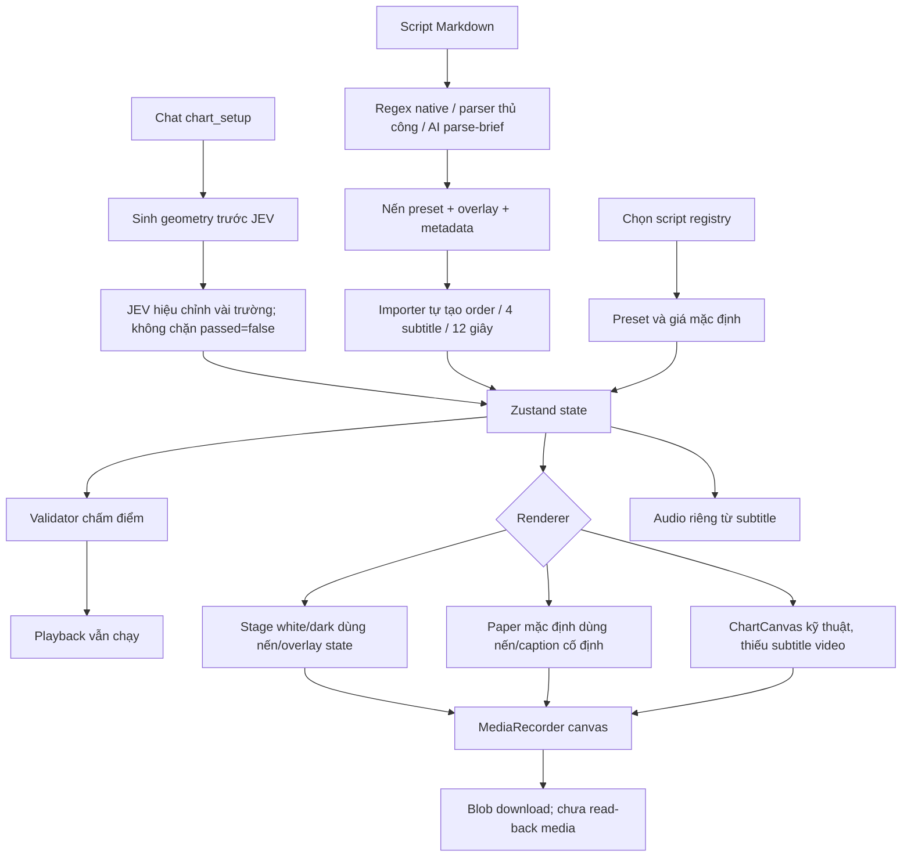

# Audit chuyên sâu: Script → Scene → Render → Video

Ngày: 2026-11-04. Verdict: **BLOCKED — chưa có pipeline sản xuất video đúng kịch bản được xác minh.**
Baseline HEAD: `a7a63e5af22c32daddd31238aa34dac8ea567b59`; audit working tree có sửa đổi sẵn. Không sửa mã ứng dụng, không gọi AI/TTS/Telegram, không mở nguồn dịch ngược, không cài REA. Các probe chỉ thực thi module thuần local trong VM.

## 1. Kết luận chính

Ứng dụng đang có nhiều bộ chuyển script thành setup, nhiều nơi tự đặt giá/chiều lệnh, và ba đường vẽ khác nhau. Không có một bản mô tả cảnh và thời gian duy nhất được dùng xuyên suốt từ script đến video. Đặc biệt, theme mặc định paper dùng dữ liệu của một video mẫu cố định, bỏ qua nến và overlay của script. Chỉnh API hoặc lấy thêm script không giải quyết được chỗ đứt này. [1–4]

Lỗi cú pháp hiện tại là blocker trước mắt. Tuy nhiên các mâu thuẫn parser, geometry, gate và export tồn tại độc lập với lỗi cú pháp. Không được coi sửa build là hoàn tất pipeline.

## 2. Skill, agent, workflow và REA/JEV thực sự có gì?

| Thành phần | Đã đọc/đối chiếu | Vai trò và trạng thái |
|---|---|---|
| 4 skill .agents | hermes-director, hermes-hook-retention, hermes-smc-verifier, hermes-funnel-architect | Hướng dẫn đạo diễn, hook, toán setup, CTA; đây là instruction cho agent, không phải các bước render tự thực thi |
| 3 skill .claude | hermes_director.md, setup_verifier.md, video_pipeline.md | Mô tả 6–9 nến, 4 phụ đề, kiểm định và capture; runtime chưa thực hiện đủ hợp đồng |
| Hồ sơ agent | .agents/agents/hermes/agent.md và 3 file .claude/agents | Hermes, builder, compliance auditor; AGENTS còn quy định REA và mutation QA |
| Rules | clean_room, mutation_test, canvas_rules, semantic_validation, grounded_citations | Quy tắc riêng về data, thời gian, quote; không tự bảo đảm output đúng |
| REA | .mcp.json có rea / npx -y rea-agents mcp; setup-rea.ps1 và contexte/02 | Có cấu hình và quy trình; phiên audit không có tool REA khả dụng. Không đủ bằng chứng chứng nhận parity với ChartAnimator.io |
| Tài liệu hành vi clone | contexte/01, SPEC, PLAN | Có mô tả tính năng tổng quát; chưa phải bộ test đối chiếu input/output/frame chứng minh clone đúng |
| JEV runtime | jevReflexGate.ts, gọi từ HermesSidebarPanel và AzzamOpsModal | Hàm heuristic/auto-calibration nội bộ, không phải máy render hoặc visual QA |
| Workflow kiểm tra | verify_goal.js, verify_grounding.js, run-mutation-test.ps1, ci.yml | Test logic/ledger; chưa có nghiệm thu media đầu cuối. Mutation runner giả lập đã ghi ở audit trước |
| Workflow script upstream | WF22 YAML, canonical cross-repo spec và hai capability manifest | YAML đọc được đi write_full_scripts → prepare_content_package → method_gate → aegis; chưa thấy bước render ChartAnimator |
| Pipeline P3 | SPEC/PLAN/DEBATE/HERMES-CLI-BRIEF P3 | Vẫn PLANNING_ONLY. /render, bridge API, adapter nguyên tử, FFmpeg/ffprobe receipt còn là kế hoạch trong chart repo |

Đã đọc các file định tuyến cốt lõi, toàn bộ 7 skill nội bộ, 4 hồ sơ agent, các rules, các đoạn liên quan trong hồ sơ P3/cross-repo và mã ở các điểm nối pipeline. Không tuyên bố đã kiểm toán mọi file dữ liệu khán giả/khóa học, toàn bộ hệ thống upstream, hay parity của website bên thứ ba.

Phân biệt quan trọng: **tái tạo công cụ ChartAnimator** là dựng một editor/renderer nhận dữ liệu bất kỳ; **tái tạo một YouTube Short** là một preset cụ thể. Code paper mang tên REA + JEV nhưng đang thực hiện việc thứ hai, rồi được dùng làm theme mặc định cho việc thứ nhất. [1–4]

## 3. Luồng hiện tại và các điểm mất dữ liệu

## 4. Findings theo ảnh hưởng

### F1 — P1: Script không quyết định hình ở theme mặc định

Store mặc định `stageTheme: 'paper'`. StageCanvas chuyển vào paper rồi return; paper không đọc candles/overlays từ options mà duyệt `REA_ORIGINAL_CANDLES`. Script SELL/FVG với giá mới có thể đổi store và lời đọc nhưng không đổi nguồn nến được vẽ. Paper cũng không nhận executionOrder, scriptSubtitles hay badges. Đây là lỗi ranh giới renderer, không phải lỗi API. [1–4]

### F2 — P1: Nội dung script bị thay bằng demo 12 giây

Importer đặt duration=12 và ghi bốn câu subtitle chung cho mọi script. Native engine có trích outline/timestamp/chartNeed nhưng apply không chuyển chúng thành các cảnh theo thời gian. Các sự kiện paper ở 36/45/52 giây không thể xuất hiện trong clip 12 giây. [5–7]

### F3 — P1: Parser bỏ mất tham số và nhầm đơn vị

Parser thủ công trả riskBudget/slPips/rrRatio nhưng applyTextParse chỉ giữ headline/subline/setup/basePrice. Apply khởi tạo risk=$10/SL20/RR3.5, nhánh AI không có hợp đồng order/timeline đầy đủ. Native parser với `Buy FVG retest at $4,132.50. Risk $10. SL 20 pips. R:R 1:3.5.` trả basePrice=4128, riskBudget=30, lotSize=$1.50/pip. Importer bỏ ký tự rồi gán 1.5 vào trường lot. Đây là mất thông tin và đổi đơn vị, không phải diễn giải hợp lệ. [8–10]

### F4 — P1: Hướng lệnh, FVG và R:R có nhiều phép tính mâu thuẫn

Probe module engine thật:

- Liquidity Sweep sinh short overlay 4135 → 4118, nhưng classifier ở chat/sidebar suy ra BUY.
- FVG 4128–4137 có midpoint 4132.5; overlay tên “Buy FVG 50% CE” đặt entry 4135.5; chat lại dùng entry 4128.
- Đổi RR từ 2 sang 7 ở Risk-First vẫn giữ geometry 4128 → 4135, chỉ đổi nhãn.

Một video vì vậy có thể đồng thời nói, vẽ và hiển thị ba giá entry khác nhau. [11–13]

### F5 — P1: JEV chưa kiểm tra đối tượng cuối cùng được render

Sidebar sinh và đưa geometry vào store trước khi gọi JEV. Payload JEV không chứa candles/overlays; output đã hiệu chỉnh SL/RR không được dùng để tái dựng geometry. Không kiểm tra `jevAudit.passed` để dừng apply. AzzamOps cũng chỉ lấy subtitles đã hiệu chỉnh. [14–15]

JEV có `const collisionSafeGate = true`, không đo bounding box/pixel. `lotSize='999 lot'` vẫn pass vì chỉ kiểm tra có chuỗi “lot”. Payload không có candles, audio hay subtitles vẫn pass cả bốn gate. “Acoustic sync” chỉ so text hook, không đo waveform, thời lượng hay alignment. [16–17]

### F6 — P1: Auditor có thể chứng nhận dữ liệu sai

Probe trực tiếp validateAndNormalizeSetup:

| Ca lỗi | Kết quả thực tế |
|---|---|
| BUY entry4128, SL4130, TP4125 | score80, isValid=true, riskRewardValid=false |
| 3 subtitle không liên quan, timestamp 0.8 → 0.1 → 0.3 | score100, isValid=true |
| Nến đầu open4120 nhưng high0 | score100, isValid=true |

Nguyên nhân: lỗi tài chính chỉ trừ điểm, `isValid = score >= 80`; subtitles chỉ cần length≥3; geometry không kiểm OHLC toàn mảng. UI còn ghi PASS 100% cho isSafe từ ngưỡng80. Importer vẫn playback sau validate mà không đọc kết quả. [18–21]

### F7 — P1: Chọn script và auto-fix có thể viết lại ý nghĩa

ScriptSetupPanel dùng keyword rộng gồm `loss|sl` để suy SELL, lấy candles nếu có nhưng dựng order tại các giá cố định. Auto-normalizer lấy close của trigger làm entry và thay subtitles bằng bốn câu mẫu; không sửa toàn bộ overlay/nến để đồng nhất. “Sửa tất cả” có thể tạo một setup khác với script ban đầu. [22–23]

### F8 — P1: Timeline, voice và export không dùng chung một bản dựng

Importer không xóa voice cũ khi thay script. Voice generation giữ state trước await và nhận audio trả về mà không đối chiếu revision script. TTS không trả timed scene alignment; Web Speech hủy câu đang đọc khi qua mốc subtitle. NLE chia block subtitle đều nhau thay vì theo timePercent. Export đặt isPlaying=false và chỉ capture canvas, không mux audio. Kết quả preview/lời đọc/file video không có hợp đồng đồng bộ chung. [24–27]

### F9 — P1: Working tree hiện tại không parse được

Probe TypeScript xác nhận renderer lỗi TS1109:289, TS1005:784; test renderer lỗi TS1005:201–202. Không có bằng chứng trình duyệt hiện tại render thành công. Các finding từ static control-flow được phân biệt với runtime; không giả vờ đã xem video mới của working tree.

### F10 — P2: Clone/parity và nghiệm thu video còn thiếu

Reveal mode được khai báo instant/sequential/wick-then-body/brownian nhưng renderer thường vẫn chỉ cắt mảng nến theo progress. Độ phân giải lấy từ preview × DPR; recorder setTimeout/MediaRecorder không chứng minh frame-accurate. P3 đã mô tả route render/status API/ffprobe/hash nhưng source chưa có chúng. CI chỉ chạy Vitest; test logic không chứng minh một MP4 đúng script, đúng âm thanh và bố cục. [28–30]

## 5. Thứ tự sửa để có video đầu tiên đúng

1. Khôi phục baseline parse được, giữ nguyên và đối chiếu các thay đổi đang có; không reset toàn bộ.
2. Chọn một script fixture rõ ràng, đóng băng text/giá/hướng lệnh/các mốc cảnh. Viết expected output cụ thể cho từng cảnh.
3. Dùng một hợp đồng scene/timeline: source script, candles, overlay refs, order, captions, narration và start/end time. Không truyền lot bằng chuỗi chứa nhiều loại đơn vị.
4. Chuyển tất cả đầu vào qua một adapter nguyên tử; không để importer/chat/registry tự tính order riêng. JEV kiểm trước khi nạp và kiểm lại dữ liệu cuối; không tự đổi nội dung mà vẫn gọi là bảo toàn script.
5. Theme chỉ thay phong cách hiển thị. Nến, overlay, captions và thời gian phải lấy từ scene. Tách video replica thành preset tham chiếu rõ ràng.
6. Preview và export dùng cùng renderFrame(scene,time), kích thước đầu ra cố định; voice dùng cùng timeline và được mux vào video.
7. Chặn cứng các lỗi OHLC, hướng lệnh, entry/CE, order, time ordering và source mismatch. Tách pass logic, pass hình, pass audio, pass file; không gọi điểm80 là đúng100%.
8. Xuất một file thật; ffprobe kiểm resolution/FPS/duration/audio, đọc frame ở từng mốc, đối chiếu subtitle/nến/overlay/voice với script. Sau khi fixture này đạt mới nối workflow WF22.

Tiêu chí video đầu tiên: khác script A/B phải khác scene và các frame tương ứng; BUY/SELL không trái nhau; CE khớp overlay/order/lời đọc; không mất câu; watermark hiện đúng; có audio khi yêu cầu; file MP4 đọc được, đúng profile. Một badge PASS hay Blob tải xuống không đủ.

## 6. Bằng chứng và giới hạn

- `script_render_probe_2026-11-04.cjs` và JSON cùng tên: chạy offline, networkCalls=0; tái hiện JEV false-positive, validator false-positive, parser, FVG và RR.
- Probe không phải bộ test nghiệm thu production, không đo pixel/frame codec, không sửa tính năng.
- Không chạy full suite vì test feedback có side effect; không dùng thông số thị trường hiện tại để khẳng định tính đúng đắn tài chính.
- Focused tests thực thi mới: `node node_modules/vitest/vitest.mjs run tests/jevReflexGate.test.ts tests/hermesEngine.test.ts tests/inAppAuditor.test.ts tests/coordinates.test.ts tests/dynamicContentValidator.test.ts`: **5 files PASS, 32/32 tests PASS, exit 0**. Đây là bằng chứng coverage còn bỏ lọt các lỗi do probe riêng tái hiện, không phải production PASS.
- Probe `node livrables/test_reports/probe_head_paper_renderer.cjs` đã được parent chạy lại: renderer tại HEAD parseDiagnostics=0; input rỗng, 1 nến BUY giá thấp và 80 nến SELL giá cao cùng phát 358 lệnh vẽ, SHA-256 `3a982a803e4a4f2edf0f71a99500be0a949a783355576d381fa9f0921ccad069`. Positive control đổi headline tạo hash khác. Như vậy lỗi bỏ qua geometry có trước các thay đổi dirty hiện tại.
- Giới hạn probe HEAD: mock Canvas command trace tại t=56s, 360×640, duration58.5; không phải screenshot/pixel browser, không phải video xuất thực của working tree. Kết quả lưu `probe_head_paper_renderer.result.json`.
- Ledger ban đầu gồm 30 quote/source hash đã kiểm tra: 0 mismatch. Các file code sửa từ trước vẫn là 5 file/190 dòng thêm; audit chỉ thêm bằng chứng trong test_reports.

## 7. Evidence ledger tự sinh từ file

Mỗi SHA Git dưới đây là baseline. Quote là working tree tại audit; SHA-256 file được lưu kèm để phân biệt file dirty. Không có quote credential.

[1] src/store/useChartStore.ts#L199-L202 (SHA: a7a63e5af22c32daddd31238aa34dac8ea567b59; working tree)
File SHA-256: 099B303B20B5B36994B575216DD945EE8006F02EB5228D66BAF9B4692A1053C7

~~~~
  revealAnimation: true,
  activeTool: 'templates',
  stageTheme: 'paper',
  headlineText: 'BREAKOUT',
~~~~

[2] src/components/StageCanvas.tsx#L87-L102 (SHA: a7a63e5af22c32daddd31238aa34dac8ea567b59; working tree)
File SHA-256: 17E8D1237E727D45E7C8E2DA43191523B8332C6CB4262233C38115AE6EA8250D

~~~~
    // REA + JEV Clean-Room Reproduction: Exact replica of YouTube Short 2W7MgNk3Wss
    if (stageTheme === 'paper') {
      renderPaperTheme({
        ctx,
        width,
        height,
        progress,
        currentTime,
        duration,
        candles,
        overlays,
        headlineText,
        sublineText,
      });
      return;
    }
~~~~

[3] src/components/canvas/renderPaperTheme.ts#L175-L185 (SHA: a7a63e5af22c32daddd31238aa34dac8ea567b59; working tree)
File SHA-256: 36188A5B7DC7BEC24882DB44570F23F8B242F3747BBFEE07FC0D450DDB98564A

~~~~
export function renderPaperTheme(opts: PaperThemeOptions) {
  const {
    ctx,
    width,
    height,
    progress,
    currentTime,
    duration,
    headlineText,
    sublineText,
  } = opts;
~~~~

[4] src/components/canvas/renderPaperTheme.ts#L719-L723 (SHA: a7a63e5af22c32daddd31238aa34dac8ea567b59; working tree)
File SHA-256: 36188A5B7DC7BEC24882DB44570F23F8B242F3747BBFEE07FC0D450DDB98564A

~~~~
  REA_ORIGINAL_CANDLES.forEach((c, idx) => {
    if (progress < c.phase) return;
    if (timeSec < c.startSec) return;

    const cx = chartLeft + (idx + 1) * candleSpacing;
~~~~

[5] src/components/BriefImporterModal.tsx#L638-L650 (SHA: a7a63e5af22c32daddd31238aa34dac8ea567b59; working tree)
File SHA-256: B900DF89FCF7893F02DDB54DA5784F230B26A14411315391196F8A380F794059

~~~~
      useChartStore.getState().setBadges(hermesDirective.badges);
    }
    useChartStore.setState({ duration: 12 });

    clearAllCandles();

    // 2. Priority: Hermes Directive -> AI Result -> Generator
    let dir: 'BUY' | 'SELL' = 'BUY';
    let riskB = 10;
    let slP = 20;
    let rr = 3.5;
    let lotStr = '0.05 lot';

~~~~

[6] src/components/BriefImporterModal.tsx#L700-L705 (SHA: a7a63e5af22c32daddd31238aa34dac8ea567b59; working tree)
File SHA-256: B900DF89FCF7893F02DDB54DA5784F230B26A14411315391196F8A380F794059

~~~~
      scriptSubtitles: [
        { timePercent: 0.0, text: `Khóa rủi ro 1R ($${riskB}) trước khi nhìn chart!`, stageName: 'Hook' },
        { timePercent: 0.28, text: `Thị trường test lại cản kỹ thuật, dụ đám đông vào lệnh cảm xúc.`, stageName: 'Trap' },
        { timePercent: 0.58, text: `Nến xác nhận đảo chiều. Chuẩn bị vào lệnh ${dir} ${lotNum} lot.`, stageName: 'Setup' },
        { timePercent: 0.82, text: `Khóa SL ${slP} pips ($${riskB}), chốt lời +${targetPips} pips (1:${rr} R:R).`, stageName: 'Execution' },
      ],
~~~~

[7] src/components/canvas/renderPaperTheme.ts#L648-L655 (SHA: a7a63e5af22c32daddd31238aa34dac8ea567b59; working tree)
File SHA-256: 36188A5B7DC7BEC24882DB44570F23F8B242F3747BBFEE07FC0D450DDB98564A

~~~~
  // 4i. Long Position Tool (Profit Target & Entry Pill from 45s onwards)
  if (timeSec >= 45.0) {
    const posStartX = chartLeft + 12 * ((chartRight - chartLeft) / 18);
    const posWidth = chartRight - posStartX;

    // Green Profit Box
    ctx.fillStyle = 'rgba(22, 163, 74, 0.25)';
    ctx.fillRect(posStartX, yDailyHigh, posWidth, yEntry - yDailyHigh);
~~~~

[8] src/components/BriefImporterModal.tsx#L525-L531 (SHA: a7a63e5af22c32daddd31238aa34dac8ea567b59; working tree)
File SHA-256: B900DF89FCF7893F02DDB54DA5784F230B26A14411315391196F8A380F794059

~~~~
  const applyTextParse = (text: string) => {
    const res = parseBriefText(text);
    setParsedHeadline(res.headline);
    setParsedSubline(res.subline);
    setSelectedSetup(res.setupType);
    setBasePrice(res.basePrice);
  };
~~~~

[9] src/utils/hermesEngine.ts#L296-L303 (SHA: a7a63e5af22c32daddd31238aa34dac8ea567b59; working tree)
File SHA-256: E85ACC02AD2E5F02DEB4DFDD86A190749A4EB5C7112892883AB02A8B51950C0A

~~~~
  let basePrice = 4128.0;
  let riskBudget = 30;
  let slPips = 20;
  let lotSize = '$1.50/pip';
  let rrRatio = 3.5;

  const budgetDirectMatch = content.match(/(?:LOSS\s*=\s*\$|define\s*\$|\$)\s*(\d+)\s*(?:=|đúng)?\s*(?:1R|budget|risk|loss|trước)/i)
    || content.match(/\$(\d+)\s*(?:=|đúng)?\s*(?:1R|budget|risk|loss)/i);
~~~~

[10] src/components/BriefImporterModal.tsx#L681-L687 (SHA: a7a63e5af22c32daddd31238aa34dac8ea567b59; working tree)
File SHA-256: B900DF89FCF7893F02DDB54DA5784F230B26A14411315391196F8A380F794059

~~~~
    const lotNum = parseFloat(lotStr.replace(/[^0-9.]/g, '')) || 0.05;

    useChartStore.setState({
      executionOrder: {
        type: dir,
        lot: lotNum,
        entry: parseFloat(baseP.toFixed(1)),
~~~~

[11] src/components/HermesSidebarPanel.tsx#L282-L288 (SHA: a7a63e5af22c32daddd31238aa34dac8ea567b59; working tree)
File SHA-256: D722B0F788E02A3E45B85F4FCE3E1CEC826331311E602C18EABAB32B30AEB701

~~~~
    const dir: 'BUY' | 'SELL' = /sell|supply|bearish/i.test(payload.strategy) ? 'SELL' : 'BUY';
    const baseP = payload.basePrice || 4128.0;
    const slPips = payload.slPips || 20;
    const rrRatio = payload.rrRatio || 3.5;
    const riskBudget = payload.riskBudget || 10;
    const targetPips = Math.round(slPips * rrRatio);
    const lotNum = parseFloat((payload.lotSize || '0.05 lot').replace(/[^0-9.]/g, '')) || 0.05;
~~~~

[12] src/utils/hermesEngine.ts#L80-L97 (SHA: a7a63e5af22c32daddd31238aa34dac8ea567b59; working tree)
File SHA-256: E85ACC02AD2E5F02DEB4DFDD86A190749A4EB5C7112892883AB02A8B51950C0A

~~~~
        type: 'FVG',
        startCandleIndex: 1,
        endCandleIndex: 4,
        priceStart: basePrice,
        priceEnd: basePrice + 9.0,
        color: '#00F5A0',
        label: `M15 Bullish FVG [${basePrice.toFixed(1)} - ${(basePrice + 9.0).toFixed(1)}]`,
      },
      {
        id: 'fvg-rr',
        type: 'LONG_SHORT',
        startCandleIndex: 4,
        endCandleIndex: 5,
        priceStart: basePrice + 7.5,
        priceEnd: basePrice + 23.0,
        color: '#00F5A0',
        label: `Buy FVG 50% CE | 1:${rrRatio} RR`,
      },
~~~~

[13] src/utils/hermesEngine.ts#L213-L216 (SHA: a7a63e5af22c32daddd31238aa34dac8ea567b59; working tree)
File SHA-256: E85ACC02AD2E5F02DEB4DFDD86A190749A4EB5C7112892883AB02A8B51950C0A

~~~~
        priceStart: basePrice,
        priceEnd: basePrice + 7.0,
        color: '#00F5A0',
        label: `Budget $${riskBudget} (1R) | Size: ${lotSize} | 1:${rrRatio} RR`,
~~~~

[14] src/components/HermesSidebarPanel.tsx#L293-L302 (SHA: a7a63e5af22c32daddd31238aa34dac8ea567b59; working tree)
File SHA-256: D722B0F788E02A3E45B85F4FCE3E1CEC826331311E602C18EABAB32B30AEB701

~~~~
    const { candles, overlays } = generateStrategySetup(
      payload.strategy,
      baseP,
      riskBudget,
      slPips,
      payload.lotSize || `${lotNum} lot`,
      rrRatio
    );
    candles.forEach((c) => addCandle(c));
    overlays.forEach((o) => addOverlay(o));
~~~~

[15] src/components/HermesSidebarPanel.tsx#L320-L350 (SHA: a7a63e5af22c32daddd31238aa34dac8ea567b59; working tree)
File SHA-256: D722B0F788E02A3E45B85F4FCE3E1CEC826331311E602C18EABAB32B30AEB701

~~~~
    const jevAudit = jevFastReflexVerify({
      headline: finalHeadline,
      subline: finalSubline,
      strategy: payload.strategy,
      direction: dir,
      basePrice: baseP,
      slPips,
      targetPips,
      riskBudget,
      lotSize: payload.lotSize || `${lotNum} lot`,
      rrRatio,
      scriptSubtitles: subtitlesToUse,
    });

    const finalSubtitles = jevAudit.calibratedPayload.scriptSubtitles || subtitlesToUse;
    const finalSlPips = jevAudit.calibratedPayload.slPips || slPips;
    const finalRisk = jevAudit.calibratedPayload.riskBudget || riskBudget;
    const finalRr = jevAudit.calibratedPayload.rrRatio || rrRatio;
    const finalTarget = jevAudit.calibratedPayload.targetPips || targetPips;

    useChartStore.setState({
      voiceAudioUrl: null, // Clear old audio so new voice is generated fresh
      voiceAudioBase64: null,
      duration: 12,
      executionOrder: {
        type: dir,
        lot: lotNum,
        entry: parseFloat(baseP.toFixed(1)),
        sl: parseFloat((dir === 'BUY' ? baseP - finalSlPips * 0.1 : baseP + finalSlPips * 0.1).toFixed(1)),
        tp: parseFloat((dir === 'BUY' ? baseP + finalSlPips * finalRr * 0.1 : baseP - finalSlPips * finalRr * 0.1).toFixed(1)),
        risk: finalRisk,
~~~~

[16] src/utils/jevReflexGate.ts#L81-L86 (SHA: a7a63e5af22c32daddd31238aa34dac8ea567b59; working tree)
File SHA-256: 4A96A1EB77ABD1519772CFC47DD3032C4CE67EFF9CDD8C5CD0A586389CF5A80F

~~~~
  // Rule 5: Lot size calibration
  const expectedLot = calibrated.riskBudget === 10 ? '0.05 lot' : '0.15 lot';
  if (!calibrated.lotSize || !calibrated.lotSize.includes('lot')) {
    calibrated.lotSize = expectedLot;
    interventions.push(`Jev Auto-Calibrated Lot Size -> ${expectedLot}`);
  }
~~~~

[17] src/utils/jevReflexGate.ts#L127-L132 (SHA: a7a63e5af22c32daddd31238aa34dac8ea567b59; working tree)
File SHA-256: 4A96A1EB77ABD1519772CFC47DD3032C4CE67EFF9CDD8C5CD0A586389CF5A80F

~~~~
  // --- GATE 4: Visual Anti-Collision Gate (Zero Overlap Guarantee) ---
  // Guarantees vertical safe bounds between Execution Pill and Teleprompter Subtitle
  const collisionSafeGate = true;

  const reflexTimeMs = Math.round((performance.now() - start) * 100) / 100;
  const passed = financialGate && acousticSyncGate && ohlcIntegrityGate && collisionSafeGate;
~~~~

[18] src/utils/dynamicValidator.ts#L226-L237 (SHA: a7a63e5af22c32daddd31238aa34dac8ea567b59; working tree)
File SHA-256: 62C9CFD8427FA0A194FBBC9813D9150BA49D68864C5F70C7F925447317C5B4A3

~~~~
  if (input.executionOrder) {
    const o = input.executionOrder;
    if (o.type === 'BUY') {
      if (o.tp <= o.entry || o.entry <= o.sl) {
        riskRewardValid = false;
        warnings.push('Cấu trúc giá lệnh BUY không hợp lệ (cần TP > Entry > SL).');
        score -= 20;
      } else {
        const rr = (o.tp - o.entry) / (o.entry - o.sl);
        if (rr < 2.8) {
          riskRewardValid = false;
          warnings.push(`Tỷ lệ R:R quá thấp (${rr.toFixed(1)} < 1:3.0).`);
~~~~

[19] src/utils/dynamicValidator.ts#L256-L267 (SHA: a7a63e5af22c32daddd31238aa34dac8ea567b59; working tree)
File SHA-256: 62C9CFD8427FA0A194FBBC9813D9150BA49D68864C5F70C7F925447317C5B4A3

~~~~

  // 5. Validate Subtitles
  let subtitlesAligned = true;
  if (!input.scriptSubtitles || input.scriptSubtitles.length < 3) {
    subtitlesAligned = false;
    warnings.push('Thiếu phụ đề 4 bước khớp với dòng thời gian video.');
    score -= 10;
  }

  // Bound score 0 -> 100
  score = Math.max(0, Math.min(100, score));
  const isValid = score >= 80;
~~~~

[20] src/components/AuditorPanel.tsx#L35-L37 (SHA: a7a63e5af22c32daddd31238aa34dac8ea567b59; working tree)
File SHA-256: 07E15F7FBD7F51AAAB6097746C814591A799678AA56A5DC5A442CBCD7E2F34C3

~~~~
  const isSafe = (report?.isValid ?? true) && score >= 80;

  const checks = report?.checks || {
~~~~

[21] src/components/BriefImporterModal.tsx#L709-L714 (SHA: a7a63e5af22c32daddd31238aa34dac8ea567b59; working tree)
File SHA-256: B900DF89FCF7893F02DDB54DA5784F230B26A14411315391196F8A380F794059

~~~~
    useChartStore.getState().validateCurrentSetup();

    // 3. Play video immediately
    setCurrentTime(0);
    setIsPlaying(true);
    onClose();
~~~~

[22] src/components/ScriptSetupPanel.tsx#L227-L234 (SHA: a7a63e5af22c32daddd31238aa34dac8ea567b59; working tree)
File SHA-256: E02AEDAEA1ADD9B329C2184D6E8CA0DB595ED78F2AC6BB038C82E39DA612AF06

~~~~
    setExecutionOrder({
      type: setupDir,
      lot: 0.05,
      entry: 4128.0,
      sl: isScSell ? 4130.0 : 4126.0,
      tp: isScSell ? 4121.0 : 4135.0,
      risk: 10,
    });
~~~~

[23] src/utils/dynamicValidator.ts#L269-L308 (SHA: a7a63e5af22c32daddd31238aa34dac8ea567b59; working tree)
File SHA-256: 62C9CFD8427FA0A194FBBC9813D9150BA49D68864C5F70C7F925447317C5B4A3

~~~~
  // 6. Generate Auto-Normalized Setup if needed
  const basePrice = input.candles && input.candles.length > 0 ? input.candles[triggerIdx]?.close || input.candles[0].open : 4130.0;
  const normalizedOrder = enforceRiskFirstMath(basePrice, expectedDirection, {
    riskBudget: customRisk,
    slPips: customSlPips,
    rrRatio: 3.5,
  });
  normalizedOrder.lot = customLot;

  const targetPips = Math.round(customSlPips * 3.5);

  const normalizedSetup = {
    executionOrder: normalizedOrder,
    calloutPinText:
      expectedDirection === 'BUY'
        ? `🎯 RÚT CHÂN QUÉT ĐÁY HỖ TRỢ ($${basePrice.toFixed(0)})`
        : `🎯 BẪY DỤ BUY QUÉT ĐỈNH ($${basePrice.toFixed(0)})`,
    calloutCandleIndex: triggerIdx,
    targetPips,
    scriptSubtitles:
      expectedDirection === 'BUY'
        ? [
            { timePercent: 0.0, text: `Khóa rủi ro 1R ($${customRisk}) trước khi nhìn chart!`, stageName: 'Hook' as const },
            { timePercent: 0.28, text: 'Cú rút chân quét đáy thanh khoản chạm vùng Hỗ trợ then chốt!', stageName: 'Trap' as const },
            { timePercent: 0.58, text: `Nến đảo chiều xác nhận. Chuẩn bị vào BUY ${customLot} lot.`, stageName: 'Setup' as const },
            { timePercent: 0.82, text: `Đặt lệnh BUY, SL ${customSlPips} pips ($${customRisk}), chốt lời +${targetPips} pips (1:3.5 RR).`, stageName: 'Execution' as const },
          ]
        : [
            { timePercent: 0.0, text: `Khóa rủi ro 1R ($${customRisk}) trước khi nhìn chart!`, stageName: 'Hook' as const },
            { timePercent: 0.28, text: 'Đây là cái bẫy quét thanh khoản đỉnh của Market Maker dụ Retail!', stageName: 'Trap' as const },
            { timePercent: 0.58, text: `Nến rút râu để lại Bearish FVG. Chuẩn bị vào SELL ${customLot} lot.`, stageName: 'Setup' as const },
            { timePercent: 0.82, text: `Đặt lệnh SELL, SL ${customSlPips} pips ($${customRisk}), chốt lời +${targetPips} pips (1:3.5 RR).`, stageName: 'Execution' as const },
          ],
  };

  return {
    isValid,
    score,
    expectedDirection,
    checks: {
~~~~

[24] src/store/useChartStore.ts#L265-L292 (SHA: a7a63e5af22c32daddd31238aa34dac8ea567b59; working tree)
File SHA-256: 099B303B20B5B36994B575216DD945EE8006F02EB5228D66BAF9B4692A1053C7

~~~~
  generateVoiceover: async () => {
    const state = get();
    if (state.isVoiceGenerating) return false;

    set({ isVoiceGenerating: true });
    try {
      const res = await fetch('/api/tts/generate', {
        method: 'POST',
        headers: { 'Content-Type': 'application/json' },
        body: JSON.stringify({
          subtitles: state.scriptSubtitles,
          voice: state.selectedVoice,
        }),
      });

      if (!res.ok) {
        if (res.status === 429) {
          console.warn('Gemini 3.8 Flash TTS Free Tier quota exceeded (10/day). Falling back to Web Speech Engine.');
          set({ hasTtsQuotaExceeded: true, audioEngine: 'webspeech' });
          return false;
        }
        throw new Error(`TTS API failed: ${res.status}`);
      }

      const data = await res.json();
      if (data.audioBase64) {
        state.setVoiceAudio(data.audioBase64, data.mimeType || 'audio/wav');
        set({ audioEngine: 'gemini', hasTtsQuotaExceeded: false });
~~~~

[25] src/components/NleTimeline.tsx#L308-L314 (SHA: a7a63e5af22c32daddd31238aa34dac8ea567b59; working tree)
File SHA-256: 3550F277A1D31DA41BB31895302F6210074EF96B37F8C6E3589AD4FF576F404B

~~~~
                  const widthPercent = (100 / scriptSubtitles.length).toFixed(1);

                  return (
                    
 {
        // Drive timeline frame-by-frame
        setCurrentTime(timeSec);
      },
~~~~

[28] src/components/ChartCanvas.tsx#L244-L250 (SHA: a7a63e5af22c32daddd31238aa34dac8ea567b59; working tree)
File SHA-256: A2E85E76D440B33B7B7F996EE69F380B0E7ED7DDC4A17F1278E6656958A75AEA

~~~~
    // Determine how many candles to reveal based on currentTime and revealMode
    let visibleCount = candles.length;
    if (duration > 0) {
      const progress = Math.min(1, Math.max(0, currentTime / duration));
      visibleCount = Math.max(1, Math.ceil(progress * candles.length));
    }
    const visibleCandles = candles.slice(0, visibleCount);
~~~~

[29] src/components/StageCanvas.tsx#L77-L81 (SHA: a7a63e5af22c32daddd31238aa34dac8ea567b59; working tree)
File SHA-256: 17E8D1237E727D45E7C8E2DA43191523B8332C6CB4262233C38115AE6EA8250D

~~~~
    canvas.width = rect.width * dpr;
    canvas.height = rect.height * dpr;
    ctx.scale(dpr, dpr);

    const width = rect.width;
~~~~

[30] livrables/specs/SPEC-P3-CHARTANIMATOR-LOCAL-RENDERER-v1.md#L75-L84 (SHA: a7a63e5af22c32daddd31238aa34dac8ea567b59; working tree)
File SHA-256: 932CD8180F6B90A3355AD2B4813961651BEABEFE8ED344EF48604B50B1A8374F

~~~~
- FFmpeg/ffprobe are available through the installed FFmpeg toolchain.

Not implemented:

- `/render` route;
- exact directive validator;
- atomic directive-to-store adapter;
- stable render Canvas identity;
- `window.chartAnimatorBridge` status API;
- supervised Playwright process;
~~~~

